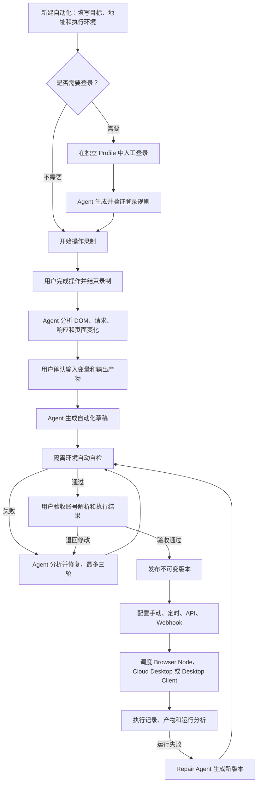
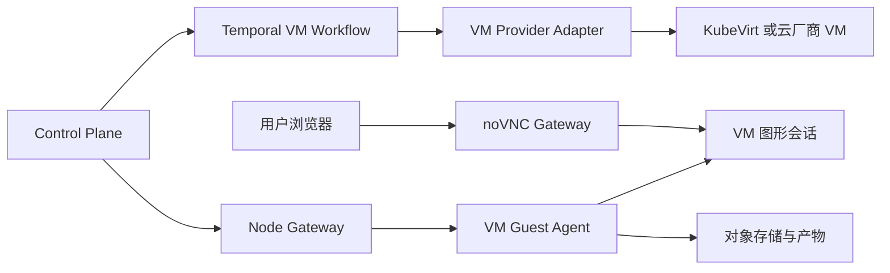
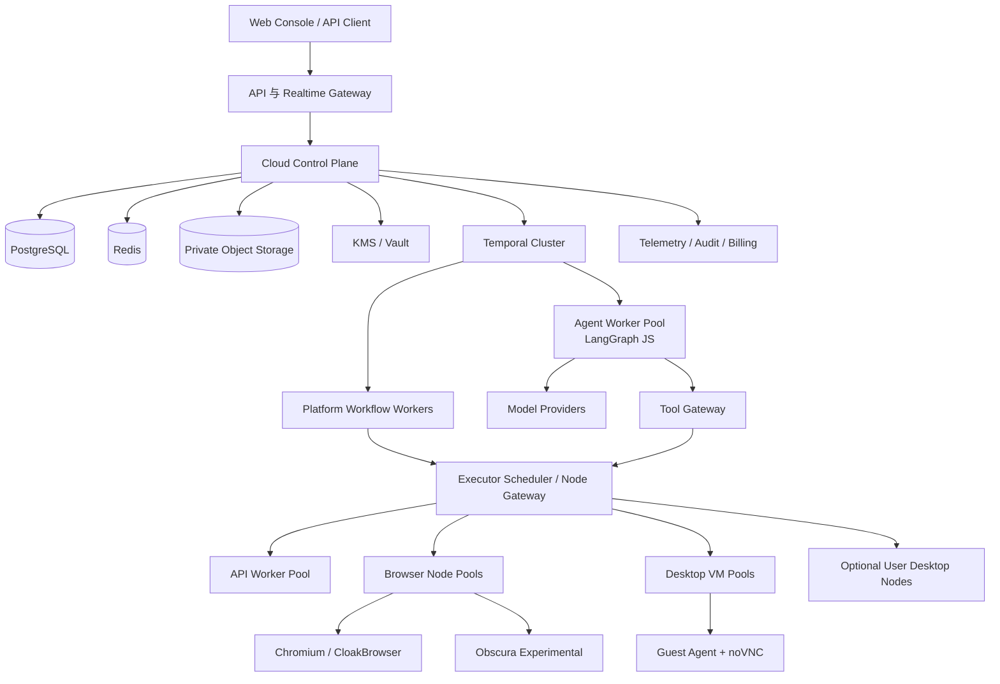

# MediaGen 云端多租户开放自动化平台完整方案

> 文档状态：V2 云端优先方案评审稿
>
> 更新时间：2026-07-10
>
> 适用范围：云端控制平面、Web Console、Agent Worker、Browser Node、桌面虚拟机、桌面客户端、插件运行时和开放 API

## 1. 执行摘要

MediaGen 可以在保留现有媒体接口能力的基础上，升级为普通用户也能使用的云端多租户开放自动化平台，不需要把现有浏览器、插件和媒体接口全部推倒重写。

项目以云端部署为主，桌面客户端是可选执行节点。平台同时支持：

- 云端浏览器自动化。
- 云端桌面软件自动化。
- 用户本机浏览器和桌面软件自动化。
- API-only 自动化。
- 多租户、团队成员、服务账号和用户级 API 鉴权。
- 服务端 Agent 多实例、多并发和断点恢复。
- 多个 Browser Node、Desktop VM Node 和专属执行节点池。

新平台的核心模式是：

```text
用户录制一次真实操作
  -> 系统采集 DOM、网络、页面变化和执行产物
  -> Agent 理解目标、登录状态、输入变量和输出结果
  -> Agent 生成强类型自动化草稿
  -> 确定性编译器生成可执行插件
  -> 调度器选择合适的 Browser Node 或 Desktop VM
  -> Agent 在租户隔离环境中自检和修复
  -> 用户验收后发布不可变版本
  -> 通过手动、定时、API 或 Webhook 稳定执行
  -> 失败时由 Repair Agent 生成新版本并重新验收
```

这里需要避免两个极端：

- 不能只靠固定程序规则完成插件开发，否则普通用户仍然无法处理页面差异、接口依赖和业务语义。
- 不能让 Agent 在每次正式执行时临场决定每一个点击，否则速度、成本、稳定性和可审计性都会下降。

最终原则是：

> Agent 负责开发、测试和维修自动化；已经发布的自动化默认由确定性 API/DOM 计划执行。

本方案的核心架构决策：

1. 云端控制平面是租户、自动化、运行、调度、审批和审计的事实来源。
2. Temporal 负责跨服务的耐久业务流程，LangGraph JS 负责 Agent 推理图，不自研这两类底座。
3. Agent 先生成强类型 AutomationSpec，再由确定性编译器生成插件。
4. 登录检查、普通执行、重试和安全回退默认不依赖大模型。
5. Browser Node、Desktop VM Node 和本机 Desktop Node 使用统一执行协议并可横向扩容。
6. 浏览器通过 BrowserEngineAdapter 解耦：Chromium 是生产基线，CloakBrowser 通过现有链路回归后用于生产，Obscura 只作为按能力启用的实验引擎。
7. 插件采用草稿、自检、用户验收、不可变发布、灰度和回滚体系。
8. Rust 保持通用执行原子能力，所有网站和桌面软件特有规则继续留在插件包中。
9. 现有媒体接口成为自动化平台上的内置自动化，不删除现有能力。
10. Workova 作为成熟模块供体，不迁移其旧 Agent Loop、旧自动化 DSL 和单机运行态。

## 2. 产品定位

### 2.1 面向用户的产品定义

产品面向普通用户统一使用“自动化”这个名称，不要求用户理解插件、Manifest、DOM Selector、HAR 或 CDP。

用户能够完成：

- 新建自动化并描述希望完成的目标。
- 选择是否需要登录以及使用哪个账号。
- 在远程浏览器中完成一次人工登录。
- 录制一次完整业务操作。
- 选择哪些内容是输入变量，哪些内容是执行结果。
- 让 Agent 自动生成、测试和修复自动化。
- 验收后发布并生成专属 API。
- 配置定时任务、Webhook、批量输入和账号池。
- 查看执行记录、下载产物并让 Agent 分析失败。
- 选择在共享云端、专属云端或自己的桌面客户端上执行。
- 创建即用即开的云桌面，或为聊天软件购买长期在线桌面。

“插件”只作为平台内部实现概念存在。普通用户看到的是：

- 自动化。
- 账号。
- 录制。
- 输入变量。
- 执行结果。
- 定时任务。
- API。
- 失败修复。

### 2.2 现有媒体能力的位置

现有媒体接口不删除，而是作为自动化平台上的内置能力继续存在：

```text
MediaGen 自动化内核
├── 内置媒体自动化
│   └── 继续提供 OpenAI 兼容图片、视频和音频接口
├── 用户录制生成的自动化
│   └── 自动生成专属 REST API
└── 开发者维护的高级插件
    └── 处理需要深度定制的平台能力
```

这样能够保留现有用户和接口，又能把底层执行能力开放给更多网站和业务场景。

### 2.3 目标用户

第一阶段目标用户：

- 不会编程，但会在网页中完成业务操作的普通用户。
- 需要把重复网页操作变成定时任务或 API 的运营人员。
- 需要管理多个平台账号和独立 Profile 的团队。
- 需要快速开发内部自动化的技术支持和实施人员。
- 仍需要手写高级插件的专业开发者。
- 需要长期运行聊天、客服和办公软件的企业团队。

不同用户共用同一个自动化内核，只是入口和可见配置不同。

## 3. 总体设计原则

### 3.1 Agent 负责编写，运行时负责执行

Agent 主要参与：

- 分析登录前后变化。
- 识别用户操作的业务含义。
- 提议输入变量和输出产物。
- 生成 API、DOM 和回退策略。
- 在隔离环境中自检和修复。
- 分析生产失败并生成新版本。

正常成功的正式任务不调用 Agent，优先执行已经验证并发布的计划。

### 3.2 Agent 先生成规范，再生成插件

Agent 不直接输出一段完全自由的 JavaScript。它先生成强类型 `AutomationSpec`，由确定性编译器完成：

- Schema 校验。
- 权限校验。
- Manifest 生成。
- API 与 DOM 步骤编译。
- SecretRef 注入点生成。
- 测试用例和结果断言生成。

这样既保留 Agent 的理解能力，又避免所有稳定性都依赖模型临场发挥。

### 3.3 发布版本永远不可变

Agent 只能创建或修改 Draft Version。正式版本经过自检和用户验收后发布，后续修复必须创建新版本，不能直接覆盖生产文件。

### 3.4 Rust 保持通用原子能力

Rust 主要负责浏览器、Profile、CDP、桌面原生桥、网络、文件和通用执行原子能力。云端租户、鉴权、持久工作流、调度、配额和审计由控制平面负责，不能继续依赖某一个 Rust Server 进程的内存状态。

任何特定网站的登录规则、字段映射、接口路径、Selector 和错误分类都必须留在插件包中，不能硬编码进 Rust。

### 3.5 原始证据与 Agent 证据分离

系统可以在租户隔离的对象存储或本机加密保存完整录制，但 Agent 只能读取脱敏、裁剪和按需查询的证据。

密码、Cookie、Authorization、Token、上传文件正文和其他账号的浏览历史默认不得进入模型上下文。

### 3.6 用户始终拥有最终发布权

Agent 可以生成、测试和提出修复，但不能自行：

- 发布生产版本。
- 扩大账号或 API 权限。
- 新增定时任务。
- 重复执行结果未知的高风险操作。
- 覆盖当前稳定版本。

### 3.7 云端事实来源与执行节点分离

云端控制平面保存业务状态，执行节点只持有当前租约允许的短期状态：

- Browser Node 不拥有租户、API Key 和自动化发布权。
- Desktop VM Guest Agent 不拥有全局调度权。
- 首期云端任务不允许 Desktop Node 离线继续执行；节点必须持续持有可续租的 ExecutionLease。
- 将来如提供离线模式，只能使用隔离的 `local-only` Workspace，不参与云端任务接管；重新联网后只能追加导入版本和产物，不能合并或改写云端 Run 状态。
- 节点失联后，由云端依据 Lease、Fencing Token、幂等性和业务后置条件判断任务是否可接管。Fencing Token 只能阻止旧节点提交结果，不能撤销已经发生的外部副作用。

### 3.8 多租户从数据模型第一天建立

不能先做单用户表，再在后期给部分表补一个可空 `tenant_id`。自动化、账号、Profile、Secret、运行、产物、Agent Job 和 API Credential 从第一版开始都必须带 `workspace_id`，Repository 查询也必须强制传入 TenantContext。

## 4. 当前代码基础与差距

### 4.1 可以直接复用的能力

| 能力             | 当前实现                                                            | 复用方式                                           |
| ---------------- | ------------------------------------------------------------------- | -------------------------------------------------- |
| 独立账号 Profile | BrowserSession 已有独立 `profile_dir`，启动时使用 `--user-data-dir` | 升级为 BrowserProfile 与 ProfileLease              |
| 远程浏览器       | Console 已支持截图流、点击、输入、导航、上传和下载                  | 直接升级为登录与操作录制工作台                     |
| 登录结果         | 已有登录状态、用户 ID、用户名、邮箱和头像等统一结构                 | 扩展为版本化 LoginRecipe                           |
| CDP 通道         | 已启用 Page、Runtime 和 Network                                     | 增加完整事件总线和录制持久化                       |
| 插件运行时       | 已有 Manifest、Browser Flow 和 QuickJS Host                         | 作为确定性执行基础                                 |
| API Key          | 已有生成、哈希、限流和过期能力                                      | 扩展用户、工作空间和自动化权限范围                 |
| 本机发行         | 已有 Server、Console、Launcher、插件和 CloakBrowser 打包            | 改造为可选 Desktop/Edge Node，不再作为云端主控制面 |

代码依据：

- Profile 目录和浏览器启动参数：`crates/mediagen-browser-gateway/src/runtime.rs`。
- 登录账号字段：`apps/server/src/account_login.rs`。
- Console 登录检测：`apps/console/src/features/accounts/components/AccountAddDialog.tsx`。
- CDP Network 启用：`crates/mediagen-browser-gateway/src/manager.rs`。

### 4.2 必须补齐的能力

| 缺口          | 当前问题                                     | 目标状态                                           |
| ------------- | -------------------------------------------- | -------------------------------------------------- |
| 浏览器录制    | Network 已启用，但请求和响应没有进入录制模型 | 统一 RecordingEvent 事件流                         |
| 双策略执行    | `Hybrid` 当前仍和 Browser 使用同一条路径     | 独立 ApiPlan、DomPlan 和 FallbackPolicy            |
| 强类型自动化  | `FlowDef.steps` 还是任意 JSON                | 建立可校验的 AutomationSpec                        |
| 结构化持久化  | SQLite 主要保存整块状态快照                  | PostgreSQL 多租户业务表和对象存储                  |
| 持久调度      | 有检查间隔配置，但没有真正 Scheduler         | Temporal、任务租约、恢复、重试和并发控制           |
| Agent Runtime | 当前不存在                                   | 增加服务端 LangGraph Agent Worker Pool             |
| 多执行节点    | 浏览器跟随单个 Server 进程启动               | Browser/Desktop/API Node Registry 与能力调度       |
| 云端桌面      | 当前不存在                                   | VM Provider、Guest Agent、noVNC Gateway 和持久磁盘 |
| 插件版本      | Loader 直接读取磁盘 Manifest                 | 增加草稿、自检、发布、灰度和回滚 Registry          |
| 用户级鉴权    | Key 没有用户和自动化范围                     | Workspace、User、Automation Scope                  |
| Agent 安全    | 原始 CDP、文件和 HTTP 能力过宽               | 仅暴露受控语义工具和能力令牌                       |

相关实现位置：

- `crates/mediagen-core/src/plugin_manifest.rs` 中的 `FlowDef.steps` 仍是任意 JSON。
- `apps/server/src/store_persistence.rs` 仍主要读取整块 `state_snapshots.payload`。
- `apps/server/src/image_api.rs` 中的 Browser 与 Hybrid 当前使用相同执行路径。
- `crates/mediagen-plugin-runtime/src/plugin_loader.rs` 直接从磁盘加载 Manifest。
- `apps/server/src/store_models.rs` 的 ApiKeyRecord 没有 User、Workspace 和 Automation Scope。

### 4.3 可行性结论

这不是增加一个录制按钮就能完成的功能，而是 MediaGen 的第二代自动化内核。

分能力判断如下：

| 目标能力                                 | 可行性     | 工程难度 | 成立条件                                                      |
| ---------------------------------------- | ---------- | -------- | ------------------------------------------------------------- |
| 多账号独立 Profile 与快速登录检查        | 高         | 中       | Profile 单写租约、版本化快照和确定性 LoginRecipe              |
| 多 Browser Node 云端并发                 | 高         | 中高     | 节点协议、能力调度、容器隔离、背压和容量压测                  |
| 普通用户录制生成网页自动化               | 中高       | 高       | 第一版限制动作范围，Agent 输出强类型规范并经过真实自检        |
| 自动发现并优先执行 API                   | 中         | 高       | 请求依赖分析、幂等和副作用边界；不能承诺所有网站都能转 API    |
| 服务端 Agent 多副本并发                  | 高         | 中高     | 成熟工作流底座、租户公平队列、预算、checkpoint 和取消         |
| 真正的云端多租户                         | 高         | 高       | 从 P0 建立 Workspace、TenantContext、配额和数据隔离，不能后补 |
| 即开即用的云桌面                         | 中高       | 高       | Golden Image、Warm Pool、Guest Agent、VM Provider 和稳定网络  |
| 聊天软件长期在线                         | 技术可行   | 很高     | VM 必须持续运行，并处理软件条款、账号验证、网络和 24×7 运维   |
| Obscura 替换所有浏览器                   | 当前不可行 | 高风险   | 只能先做能力受限的实验引擎，完整浏览器继续兜底                |
| 任意网站和任意桌面软件一次录制后永久稳定 | 不合理     | 不可控   | 必须限定支持范围、版本回归、人工验收和持续修复机制            |

整体结论是：**云端浏览器自动化平台可行，云桌面也可行，但应该分阶段形成两个执行运行时；“所有场景完全自动生成并永不失败”不应成为产品承诺。**

但以下基础可以继续复用：

- 现有 OpenAI 兼容媒体 API。
- 现有平台插件和账号数据。
- CloakBrowser 及通用 CDP 原子能力。
- 本机与云端继续共用一套 AutomationSpec、插件协议和 Console 交互模型。
- 当前插件运行和账号管理体系。

需要新增的是：

```text
自动化工作室
  -> 录制与证据
  -> 云端 Agent 开发工作流
  -> 强类型自动化规范
  -> 插件编译与版本 Registry
  -> 多租户调度和执行节点网络
  -> 稳定执行、API、云桌面和产物
```

## 5. 完整用户流程



## 6. 新建自动化

用户填写：

- 自动化名称。
- 起始地址。
- 希望完成什么，例如“下载最近一个月的订单”。
- 是否需要登录。
- 使用已有账号，还是新登录一个账号。
- 自动化目标类型：网页、桌面软件、API 或混合流程。
- 执行位置：共享云端、专属云端、自己的桌面客户端或自动选择。

目标描述是必要信息。同一段页面操作可能对应不同业务目标，Agent 需要依靠目标判断：

- 哪些信息是输入。
- 哪些信息是结果。
- 哪一步具有副作用。
- 什么才算真正执行成功。

登录方式提供：

1. 不需要登录。
2. 使用已有账号或 Profile。
3. 新登录一个账号并生成登录规则。

桌面软件自动化还需要选择：

- 使用现有 Cloud Desktop。
- 新建临时 Cloud Desktop。
- 新建可暂停的持久 Cloud Desktop。
- 新建长期在线 Cloud Desktop。
- 使用已绑定的本机 Desktop Node。

发布、删除、付款、发送消息等操作应自动标记风险等级，并要求用户选择沙箱、模拟或逐次确认的测试方式。

自动化创建后进入 `draft` 状态。

## 7. 登录录制与登录状态规则

### 7.1 用户流程

如果需要新登录：

1. 控制平面创建租户隔离的 BrowserProfile 或 DesktopProfile。
2. 调度器选择满足地区、引擎、代理和资源要求的执行节点。
3. 为本次操作申请一次性 ProfileLease 和 ExecutionLease。
4. 浏览器登录打开远程网页画面；桌面软件登录打开一次性 noVNC 会话。
5. 用户正常输入账号、密码和验证码。
6. 用户点击“登录完成”。
7. 系统比较登录前后的 Cookie 名称、Storage 结构、DOM 和网络变化。
8. Agent 生成登录规则和账号信息提取规则。
9. 系统重启浏览器后再次验证。

用户输入的密码、短信验证码和 Token 不能保存进录制事件，也不能发送给 Agent。

### 7.2 LoginRecipe

最终生成版本化 `LoginRecipe`：

- 优先使用轻量用户信息接口判断登录状态。
- 接口不可用时检查 Cookie 或 Storage 结构，不向 Agent 暴露原值。
- 再使用稳定 DOM 标志辅助判断。
- 提取用户 ID、昵称、邮箱、头像和会员等级等信息。
- 记录登录页、验证页和退出状态的稳定特征。
- 保存每个 Probe 的超时、权重和失败分类。

登录状态明确区分：

```text
authenticated          已登录
expired                明确未登录或登录失效
verification_required  需要验证码或人工确认
inconclusive           网络错误、限流或暂时无法判断
blocked                账号或地区被平台阻止
```

网络超时、403、429 和 5xx 不能直接判断为登录失效。

### 7.3 快速检查机制

正常健康检查不调用 Agent，而是在 Profile 所在节点执行已经发布的 LoginRecipe；跨节点检查也必须先取得 Probe Lease，并使用只读加密快照，不能直接复制正在写入的 Profile：

```text
本地 Cookie/Storage 快速 Probe
  -> 有强登录证据：返回 authenticated
  -> 有强退出证据：返回 expired
  -> 无法确定：调用轻量用户信息 API
  -> API 仍不确定：调用 DOM Probe
  -> 仍不确定：返回 inconclusive，不误判
```

建议性能目标：

- 本地 Cookie/Storage 初筛尽量保持在 100ms 级别。
- 需要请求用户信息接口时，P95 控制在 2 秒以内。
- 只有规则失效或结果不确定时才唤醒 Agent。

### 7.4 登录规则自检

至少验证：

- 已登录 Profile 能返回正确账号信息。
- 匿名 Profile 不能被误判为已登录。
- 浏览器和服务重启后结果一致。
- 账号退出后能识别 expired。
- 限流、网络失败和平台异常返回 inconclusive。
- 验证码页面返回 verification_required。

### 7.5 多账号状态隔离

平台支持两种账号状态载体：

1. 完整 BrowserProfile。

   保存 Cookie、Storage、IndexedDB、Service Worker 和浏览器偏好等完整状态，适合登录录制、复杂网页和长期稳定账号。一个 Profile 同时只允许一个写租约。

2. 轻量 SessionState。

   只保存经过允许的 Cookie、Header Token 和必要 Storage 字段，适合 API Worker 或确认兼容的 Obscura 任务。它不能冒充完整浏览器 Profile，也不能用于依赖设备状态、IndexedDB 或 Service Worker 的网站。

每个账号独立拥有 Profile 或 SessionState、代理策略、SecretRef、登录规则和加密密钥上下文。不同账号即使属于同一用户，也不能共用可写 Cookie Jar。

## 8. 业务操作录制

### 8.1 录制范围

登录完成后与“不需要登录”的流程合并，使用同一个 Profile 和同一个执行环境开始业务录制。这样可以避免录制环境和正式执行环境能力不一致。

录制器支持以下语义动作：

- `navigate`
- `click`
- `type`
- `select`
- `checkbox`
- `radio`
- `upload`
- `download`
- `wait`
- `assertion`
- `extract`

### 8.2 每个动作保存的证据

每个有效动作关联：

- 目标元素的 role、label、name、文本和稳定属性。
- 主 Locator、备选 Locator 和元素相对关系。
- 操作前后的局部 DOM。
- 关键截图和页面状态。
- 相关请求、响应结构、状态码和耗时。
- 导航、弹窗、下载和新标签页变化。
- 操作前后的可访问性树局部信息。
- 输入类型、候选选项和校验规则。

### 8.3 DOM 保存策略

不在每一次 DOM Mutation 后保存完整页面。大型网页可能每秒产生几百次变化，全部保存会造成巨量数据。

采用以下组合：

- 操作节点保存局部 DOM。
- 关键状态保存完整快照。
- 快照之间保存增量变化。
- 对稳定属性、可访问名称和相对关系建立索引。
- 云端原始录制进入租户隔离的私有对象存储，本机模式进入本地加密证据库。
- Agent 只读取脱敏、裁剪后的证据包。

### 8.4 Network 保存策略

Network 录制保存：

- 请求方法。
- 地址和路径模板。
- Query、Header 名称和 Body Schema。
- 请求之间的 Token 或 ID 依赖关系。
- 状态码、耗时和响应 Schema。
- 操作与请求之间的时间关联。
- 响应哈希和可选的加密原文引用。

默认不把以下原值发送给 Agent：

- Cookie。
- Authorization。
- CSRF Token。
- Refresh Token。
- 密码字段。
- 上传文件正文。
- 未经用户允许的个人敏感信息。

### 8.5 多页面和下载

录制器必须支持：

- 新标签页和弹窗。
- 页面重定向。
- iframe。
- 原生文件选择框。
- 浏览器下载。
- 任务结束前仍在进行的异步请求。

每个 Target 都进入同一 RecordingSession，并保留父子来源关系。

### 8.6 桌面软件录制

桌面软件不使用 DOM 录制，而由虚拟机或本机中的 Guest Agent 记录：

- Windows UI Automation 控件树、AutomationId、ControlType 和 Name。
- Linux AT-SPI 控件树。
- macOS Apple 硬件节点上的 AXUIElement。
- 操作前后截图和目标区域。
- 应用进程、窗口、菜单、对话框和系统通知。
- 鼠标、键盘、剪贴板、文件选择器和下载结果。
- OCR、图像和坐标兜底证据。

noVNC 只负责让用户查看和人工接管虚拟桌面，不作为自动化执行引擎。正式回放优先使用 Guest Agent 的 Accessibility/UI Automation 能力，最后才使用图像和坐标。

## 9. Agent 分析录制

### 9.1 分析方式

录制完成后，不把完整 DOM 和 HAR 一次性发送给模型。

正确流程：

1. 确定性预处理器整理操作时间线。
2. 建立“动作—DOM 变化—请求—结果”的关联图。
3. 进行字段白名单脱敏。
4. Agent 先读取 RecordingSummary。
5. Agent 需要更多证据时，通过工具查询局部信息。
6. 所有 Agent 结论必须引用 Evidence ID。

### 9.2 固定角色节点

Agent 工作流包含五个固定角色节点：

1. **Auth Analyst**：生成登录状态和账号字段规则。
2. **Flow Architect**：理解用户每一步的业务作用和依赖。
3. **Variable & Output Designer**：识别输入、动态选项和输出结果。
4. **Plugin Builder**：生成强类型规范和双执行策略。
5. **QA & Repair Agent**：运行测试、分析失败并提交补丁。

这些节点属于同一个有界 LangGraph AgentJob，由外层 Temporal Workflow 调度和恢复；不采用多个 Agent 随意互相对话的不可控模式。

### 9.3 Agent 输出要求

所有节点使用结构化输出，不允许只返回自然语言结论。

每个结论至少包含：

- 结论类型。
- 置信度。
- Evidence ID。
- 风险等级。
- 是否需要用户确认。
- 建议的下一步工具。

## 10. 输入变量设计

### 10.1 支持类型

变量审查页支持：

- 文本。
- 数字。
- 布尔值。
- 日期和时间。
- 单选。
- 多选。
- 下拉枚举。
- 单文件和多文件。
- SecretRef。
- 数组。
- JSON 对象。
- 前一步输出。

### 10.2 用户可以选择的行为

每个录制值允许用户选择：

- 固定使用录制值。
- 每次执行必须传入。
- 有默认值但允许覆盖。
- 从前一步输出获得。
- 从安全凭据读取。

### 10.3 动态选项

下拉、单选和多选的选项来源支持：

- 固定使用录制时的选项。
- 每次运行从 DOM 重新读取。
- 每次运行从接口重新读取。

选项保存显示文本和值的映射，不能只保存用户看到的文字。

### 10.4 变量审查界面

建议表格字段：

| 录制值 | 建议名称 | 类型 | 默认值 | 选项来源 | 是否变量 | 是否敏感 |
| ------ | -------- | ---- | ------ | -------- | -------- | -------- |

用户的选择被写入 InputSchema，后续自动生成执行表单和 API 请求 Schema。

## 11. 输出与产物设计

### 11.1 支持的输出

输出审查页允许用户选择：

- 文本。
- 表格。
- JSON。
- 下载文件。
- 图片、视频或音频。
- 页面截图。
- 最终页面地址。
- 业务对象 ID。
- 成功状态和规范化失败原因。

### 11.2 主要结果

用户可以指定一个或多个主要结果。例如：

- “下载的 PDF 是主要结果”。
- “接口返回的 order_id 是主要结果”。
- “页面表格是主要结果”。

下载文件和网页提取数据都是正式执行结果，不只作为日志附件存在。

### 11.3 输出断言

每个重要输出可以配置：

- 是否必须存在。
- 类型和最小长度。
- 文件 MIME 和大小范围。
- JSON Schema。
- 表格必需列。
- 与输入变量的关联条件。

输出断言用于判断业务是否真正成功。

## 12. 自动化规范与插件生成

### 12.1 生成原则

Agent 不直接生成一段完全自由的 JavaScript。更稳定的方式是先生成强类型 `AutomationSpec`，再由确定性编译器生成插件。

### 12.2 每个版本包含的产物

每个自动化版本至少包含：

- `AutomationSpec`：完整业务流程。
- `LoginRecipe`：登录判断和用户信息提取。
- `InputSchema`：输入变量。
- `OutputSchema`：输出结果。
- `ApiPlan`：请求依赖、字段映射和成功断言。
- `DomPlan`：DOM 操作、等待和结果提取。
- `DesktopPlan`：桌面应用、窗口、控件、文件和视觉兜底操作。
- `FallbackPolicy`：允许回退的错误类别。
- `PermissionManifest`：域名、文件、浏览器和桌面应用权限。
- `TestCases`：登录、变量、文件和结果测试。
- `Provenance`：录制、Agent、编译器和父版本信息。
- `RollbackPointer`：上一稳定版本。

最终插件是上述规范经过编译、权限检查和签名后的不可变产物。

### 12.3 ApiPlan

ApiPlan 描述：

- 请求顺序和依赖关系。
- 输入变量如何映射到请求。
- Token、ID、上传句柄如何从前一步获得。
- 哪些 Header 由运行时注入。
- 成功和失败响应的结构。
- 幂等键和业务后置条件。
- 哪些错误允许回退到 DOM。

### 12.4 DomPlan

DomPlan 描述：

- 语义动作。
- 主 Locator 和备选 Locator。
- 元素可见、可用和稳定条件。
- 导航和请求等待条件。
- 上传、下载和弹窗处理。
- 每一步的业务后置条件。
- 失败时允许 Agent 查询的证据范围。

### 12.5 DesktopPlan

DesktopPlan 描述：

- 目标操作系统、应用 ID、允许版本和启动方式。
- 窗口、菜单、控件和对话框的可访问性定位。
- 鼠标、键盘、剪贴板和文件交互。
- 应用启动、崩溃、升级和重新登录处理。
- Accessibility 不可用时允许的 OCR、图像或坐标兜底。
- 每一步的后置条件、超时和人工接管点。
- 输出文件、通知、窗口文本和结构化结果提取。

### 12.6 PermissionManifest

权限清单至少包括：

- 允许访问的域名。
- 允许的 HTTP 方法。
- 允许读写的插件数据目录。
- 是否允许上传和下载。
- 是否允许打开新标签页。
- 是否允许使用剪贴板。
- 是否允许读取截图或 DOM。
- 允许启动的应用、进程和系统能力。
- 允许访问的桌面文件目录。
- 副作用等级。

## 13. API、DOM 与桌面策略

### 13.1 安全原则

“API 优先，失败后 DOM 回退”只能在经过验证且安全的情况下使用，不能无条件执行。

例如发布接口已经成功，但响应在网络途中超时，如果系统随后再用 DOM 点击一次，就可能重复发布。

### 13.2 回退矩阵

| 情况                           | 系统处理                               |
| ------------------------------ | -------------------------------------- |
| 只读 GET 暂时失败              | 可以重试，必要时切 DOM                 |
| API 结构变化且确认没有副作用   | 可以切 DOM                             |
| API 返回 401                   | 进入重新登录，不继续业务               |
| API 返回 429                   | 等待冷却，不通过 DOM 绕过限流          |
| POST 超时且结果未知            | 检查幂等键或业务后置条件，不盲目切 DOM |
| API 依赖一次性签名或浏览器证明 | DOM 作为主策略                         |
| 出现验证码或人工验证           | 暂停并请求用户接管                     |
| 页面和接口同时变化             | 交给 Repair Agent 分析                 |

### 13.3 三种执行模式

平台提供：

1. **稳定执行**

   默认模式。正常成功路径不调用 Agent，失败后才分析。

2. **自适应执行**

   出现元素或响应变化时，Agent 从受控候选策略中选择。

3. **实时 Agent**

   用于一次性、无法预先描述的任务，重要操作仍需审批。

定时任务和外部 API 默认只使用稳定执行模式。

### 13.4 策略选择

Agent 在生成阶段提出主策略，验证器通过真实回放决定能否发布：

- API 结果等价、认证可恢复、请求可重放时，API 可以作为主策略。
- 接口存在一次性签名、UI 证明或无法安全重放的副作用时，DOM 作为主策略。
- 两种策略都通过时才允许配置自动回退。
- 只有 DOM 通过时，插件仍然可以发布为 Browser-only。

### 13.5 跨网页与桌面的混合流程

一个 AutomationSpec 可以先调用 API，再操作网页，最后进入桌面软件，但每次运行环境切换都必须显式声明：

- 前一步输出如何传给下一步。
- 文件通过 Artifact 传递，不能依赖两个节点恰好共享本地路径。
- BrowserProfile 与 DesktopProfile 是否属于同一业务账号。
- 是否允许切换执行节点、区域和代理。
- 切换前后的幂等边界和后置条件。
- VM 未就绪、用户未登录或需要人工验证时如何暂停。

DesktopPlan 不是 DomPlan 失败后的通用兜底。只有录制和自检都证明桌面操作与网页操作业务等价时，才能配置二者回退。

## 14. 自动自检

### 14.1 静态检查

- Manifest 校验。
- AutomationSpec 校验。
- InputSchema 和 OutputSchema 校验。
- Capability 校验。
- 域名和文件权限校验。
- Secret Scan。
- 禁止危险通配 Selector。

### 14.2 登录检查

- 已登录 Profile 正例。
- 匿名 Profile 反例。
- 浏览器重启后登录状态。
- 账号退出状态。
- 限流、超时和验证码分类。

### 14.3 执行检查

- API 策略回放。
- DOM 策略回放。
- Desktop 策略在指定 OS、镜像和软件版本中回放。
- API 失败后的安全回退。
- 主 Locator 和备选 Locator。
- 文本、下拉、单选、多选和空值。
- 文件上传和下载。
- 输出提取和 Schema。
- 任务取消和超时。
- Control Plane、Workflow Worker、Agent Worker 和执行节点重启恢复。
- Profile 并发租约。
- VM 启动、Guest Agent 失联和人工接管恢复。
- 业务后置条件。

### 14.4 Agent 修复循环

建议固定为最多三轮：

```text
运行测试
  -> 生成脱敏 FailureBundle
  -> Agent 提交一个有明确理由的补丁
  -> 静态校验
  -> 重新运行失败用例和回归用例
```

超过三轮后停止并展示明确原因，避免无限消耗 Token。

付款、删除、发布和发送等有副作用流程，只能使用沙箱账号、模拟模式或用户逐次批准。

## 15. 用户验收与发布

用户验收页面展示：

- 账号解析是否正确。
- 自动生成的输入表单。
- 实际使用 API 还是浏览器。
- 每一步执行结果和耗时。
- 截图和关键网络证据。
- 提取数据和下载文件。
- 是否发生回退或 Agent 介入。
- Agent 做过哪些修复。
- 自动化申请了哪些权限。

用户可以用自然语言退回修改，例如：

- “账号名称取错了”。
- “这个下拉框不要作为变量”。
- “下载的文件才是主要结果”。
- “这一操作必须用浏览器执行”。

只有点击“验收并发布”后，才生成正式不可变版本。

## 16. 自动化状态机

### 16.1 Automation

```text
draft
  -> login_configuring
  -> recording
  -> analyzing
  -> awaiting_variable_review
  -> generating
  -> validating
  -> awaiting_acceptance
  -> published
  -> paused / deprecated
```

不需要登录时跳过 `login_configuring`。生成或验证失败进入 `repair_required`，修复后回到 `validating`。

### 16.2 RecordingSession

```text
created
  -> environment_provisioning
  -> interactive_ready
  -> recording
  -> finalizing
  -> compiled
```

异常终态：`failed`、`cancelled`。

### 16.3 AutomationVersion

```text
draft
  -> static_verified
  -> self_tested
  -> awaiting_user_acceptance
  -> active
  -> superseded / rolled_back
```

Active Version 永远不可修改。

### 16.4 WorkflowRun

```text
created
  -> queued
  -> quota_reserving
  -> leasing_profile
  -> selecting_executor
  -> preparing_environment
  -> checking_login
  -> selecting_strategy
  -> running_api / running_browser / running_desktop
  -> waiting_human
  -> finalizing
  -> succeeded
```

异常终态：`failed`、`cancelled`、`timed_out`、`login_required`、`quota_exceeded`。

只有 FallbackPolicy 明确允许时，才能从 `running_api` 转入 `running_browser`。

### 16.5 RepairIncident

```text
open
  -> collecting_evidence
  -> agent_analyzing
  -> patch_draft
  -> replaying
  -> awaiting_approval
  -> resolved
```

### 16.6 ExecutionAttempt

一次 WorkflowRun 可以因为节点丢失、引擎不兼容或可安全重试而产生多个 Attempt：

```text
created
  -> lease_pending
  -> leased
  -> starting
  -> running
  -> checkpointing
  -> succeeded
```

异常终态：`failed`、`lost`、`cancelled`、`fenced`。

每个 Attempt 独立保存 `node_id`、`engine`、`lease_id`、`fencing_token`、心跳、开始结束时间和失败分类。Run 是用户看到的一次业务运行，Attempt 是平台内部的一次具体执行尝试，两者不能混为一张状态表。

## 17. Agent 与耐久工作流底座

### 17.1 推荐结论

云端主架构采用两层成熟底座，各自只负责自己擅长的问题：

| 层次           | 推荐底座                                      | 负责什么                                                  | 不负责什么                 |
| -------------- | --------------------------------------------- | --------------------------------------------------------- | -------------------------- |
| 平台耐久工作流 | Temporal                                      | 排队、超时、重试、定时、跨服务恢复、人工等待、VM 生命周期 | 不负责理解网页和自主推理   |
| Agent 推理图   | LangGraph JS                                  | 证据分析、变量建议、插件生成、测试诊断和修复推理          | 不作为整个平台的任务调度器 |
| 确定性执行     | Rust Automation Runtime                       | LoginRecipe、ApiPlan、DomPlan、DesktopPlan、断言和回退    | 不在运行时自由发挥业务规则 |
| 实际操作       | Browser Node、Desktop Guest Agent、API Worker | 浏览器、桌面软件、网络和文件原子动作                      | 不拥有租户权限和发布权     |

这不是重复建设。Temporal 保存“这项业务目前走到哪一步”，LangGraph 保存“一次 Agent 推理内部走到哪一步”，PostgreSQL 保存正式业务数据。

### 17.2 为什么不自研 Agent Loop 和持久工作流

自研一个能调用工具的循环并不难，难的是长期稳定运行所需要的完整语义：

- Worker 重启后从正确位置恢复。
- 工具调用结果去重。
- 人工登录等待几小时或几天后继续。
- 取消、超时、重试和补偿行为一致。
- 多个 Agent Worker 不会重复消费同一任务。
- 同一租户的并发、Token 和费用不会失控。
- 版本升级时旧工作流仍能继续运行。

因此平台不复制 Workova 当前自建 ReAct、JSON/JSONL checkpoint 和进程内等待机制，也不在 MediaGen 中再实现一套相同功能。

### 17.3 Temporal 负责的业务工作流

建议至少建立五类 Workflow：

1. `AutomationAuthoringWorkflow`

   串联创建、登录、录制、Agent 分析、变量确认、生成、自检、用户验收和发布。

2. `AutomationRunWorkflow`

   负责配额预占、选择账号、申请 ProfileLease、调度节点、执行、回退、产物归档和计费结算。

3. `LoginMaintenanceWorkflow`

   定时运行轻量 LoginRecipe，识别过期账号并通知重新登录。

4. `PluginRepairWorkflow`

   聚合失败、生成修复草稿、回放、灰度、等待审批和回滚。

5. `CloudDesktopLifecycleWorkflow`

   负责创建、预热、启动、停止、快照、磁盘挂载、Guest Agent 就绪检查和销毁。

Temporal Signal 用于接收：

- 用户点击“登录完成”。
- 用户确认变量和输出。
- 用户通过或退回验收。
- 用户进入 noVNC 人工接管。
- 管理员批准高风险动作。
- 节点上报需要人工处理。

Temporal Query 只用于读取进度，正式业务数据仍写入 PostgreSQL。Temporal Namespace 按环境划分，不为每个租户创建 Namespace；租户通过 Workflow ID、Search Attribute 和应用层权限隔离。

### 17.4 LangGraph 负责的 Agent 图

LangGraph 只承载需要模型推理的有界图：

```text
读取脱敏摘要
  -> 判断还缺什么证据
  -> 调用只读证据工具
  -> 生成结构化候选
  -> 规则校验
  -> 需要补证据时继续查询
  -> 输出 AutomationSpec 或 RepairProposal
```

推荐固定节点：

- `Login Analyst`：生成 LoginRecipe 候选。
- `Trace Analyst`：把操作、DOM 和 Network 串成因果链。
- `Variable Designer`：提出输入、动态选项和默认值。
- `Output Designer`：定义结构化结果和产物。
- `Strategy Planner`：生成 ApiPlan、DomPlan、DesktopPlan 和回退边界。
- `Test Engineer`：生成测试矩阵并解释失败。
- `Repair Engineer`：对草稿做最小补丁。
- `Security Reviewer`：检查权限、敏感信息和副作用。

每个节点都必须输出 JSON Schema 可校验的结构，不能把自然语言直接当成可执行脚本。

### 17.5 Cloudflare Agents SDK 的定位

Cloudflare Agents SDK 的 Durable Object 状态、实时连接、可调用方法和调度能力适合边缘实时交互，但本项目的 Browser Node、虚拟机和已有 Workova 服务主要运行在常规云基础设施中。

因此它不作为第一阶段核心事实来源。未来如果需要全球 WebSocket 接入、边缘会话协调或远程节点入口，可以单独作为 Edge Gateway，引入时仍通过 Control Plane API 和 Temporal 交互，不能形成第二套业务状态。

### 17.6 OpenAI Agents SDK 的定位

OpenAI Agents SDK 可以作为某些 Agent 图的可选 Runner，尤其适合 OpenAI 原生 Hosted Tools、Computer Use、MCP 和审批能力。它不能替代 MediaGen 的多租户权限、Temporal 工作流和执行节点协议。

第一阶段只保留 `AgentRunnerAdapter` 接口，不同时维护两套 Agent 图实现。等真实场景证明有价值后，再增加 OpenAI Runner。

### 17.7 云端进程拓扑

```text
Temporal Cluster
├── authoring task queue
├── run task queue
├── login-maintenance task queue
├── repair task queue
└── cloud-desktop task queue

Agent Worker Pool
├── interactive-authoring workers
├── self-test workers
├── repair workers
└── low-priority-analysis workers

Execution Fabric
├── API Worker Pool
├── Browser Node Pool
├── Desktop VM Node Pool
└── optional Desktop/Edge Node Pool
```

Agent Worker 是无本地业务状态的可横向扩容服务。LangGraph checkpoint 使用 PostgreSQL；以后如增加隔离的 `local-only` 模式，可以使用 SQLite，但本机 checkpoint 不属于云端 Workflow，也不能合并为云端运行历史。

### 17.8 Temporal 部署建议

Temporal 本身也是一套需要监控、升级和备份的分布式系统。第一阶段如果团队基础设施人力有限，优先使用托管 Temporal 服务；如果数据驻留、成本或私有化要求必须自建，再使用独立数据库和生产级多副本部署。

不能把 Temporal Server 和业务 PostgreSQL 当成一个可以随意重建的开发容器，也不能在正式环境使用单副本开发配置。无论托管还是自建，Workflow 代码、Task Queue 和业务 Service 接口保持一致，避免绑定部署方式。

## 18. Agent 模型配置

### 18.1 管理后台最简配置

用户要求“只填写 Base URL、API Key 和协议”是合理的，但模型 ID 在很多兼容服务中不能永远省略。建议默认界面只展示：

- 配置名称。
- 协议。
- Base URL。
- API Key。

保存后平台自动调用模型列表接口、探测能力并推荐一个模型。只有服务端不提供模型列表或存在多个可用模型时，才要求用户选择或手动填写模型 ID。

### 18.2 首期协议

- OpenAI Responses。
- OpenAI Chat Completions Compatible。
- Anthropic Messages。

以后按需求增加 Gemini 原生协议。协议差异封装在 `ModelProviderAdapter` 中，Agent 图不判断供应商名称。

### 18.3 自动能力检测

每个 Provider 保存前运行低成本探针：

- 是否支持工具调用。
- 是否支持 JSON Schema 或稳定结构化 JSON。
- 是否支持流式响应。
- 是否支持图片输入。
- 最大上下文和最大输出。
- 限流响应和重试提示。
- 模型列表是否稳定。

不支持工具调用或结构化输出的模型，不能用于插件生成，只能作为普通文本分析模型。

### 18.4 租户级和平台级模型

支持两种来源：

1. 平台托管模型：平台付费，按照租户套餐、Token 和任务计费。
2. 租户自带模型：租户配置自己的 Provider Secret，由平台只保存 SecretRef。

每个 Agent Job 记录实际 Provider、模型、输入输出 Token、重试、延迟和估算费用，但普通日志不能记录 API Key 或完整 Prompt 中的敏感证据。

### 18.5 高级配置

高级区域提供：

- 自定义 Header。
- 代理和区域。
- 连接和响应超时。
- 最大修复轮数。
- 单任务 Token、费用和时间上限。
- 截图发送策略。
- 数据驻留区域。
- 证据保留时间。

Provider API Key 使用 KMS 或 Vault 信封加密，数据库只保存 SecretRef 和密文元数据。

## 19. 服务端 Agent 多并发设计

### 19.1 并发原则

Agent 并发不能简单等同于多开几个 Node 进程。平台必须同时控制：

- 每个租户的并发任务数。
- 每个模型供应商和 API Key 的速率。
- 每个任务的 Token、费用和运行时间。
- 交互任务与后台修复任务的优先级。
- Browser Node 和 VM 是否有可用资源。
- 同一自动化草稿是否正在被另一个 Agent 修改。

### 19.2 队列与优先级

至少拆分四类任务队列：

| 队列                  | 优先级 | 场景                                     | 默认并发策略             |
| --------------------- | -----: | ---------------------------------------- | ------------------------ |
| interactive-authoring |   最高 | 用户正在等待登录分析、变量建议和验收修改 | 小批量、低延迟           |
| self-test             |     高 | 草稿生成后的自动测试                     | 受 Browser Node 容量限制 |
| repair                |     中 | 生产失败后的分析和补丁                   | 按自动化聚合并去重       |
| scheduled-analysis    |     低 | 统计、回归和离线优化                     | 可延迟、可抢占           |

不能让一个大租户的大批量修复占满所有 Worker。调度采用加权公平队列，并在租户、工作空间、Provider Key 和任务类型四个维度限流。

### 19.3 AgentJob 状态与租约

```text
queued
  -> quota_reserved
  -> running
  -> waiting_tool / waiting_human
  -> succeeded
```

异常终态：`failed`、`cancelled`、`timed_out`、`budget_exceeded`。

每个 Job 使用唯一幂等键、尝试号和 Fencing Token。Worker 失联后新 Worker 可以重放安全步骤；旧 Worker 即使恢复，也不能用过期 Token 提交最终结果。

### 19.4 Checkpoint 与恢复

- LangGraph checkpoint 保存 Agent 内部节点、消息引用和结构化中间结果。
- 大 DOM、截图、HAR 和文件只存对象存储，checkpoint 保存 Artifact ID。
- Temporal 保存 Agent Activity 是否已开始、完成、超时或重试。
- 用户取消时向 Temporal 发出取消请求，Worker 在工具边界检查取消标记。
- 模型调用失败只重试无副作用请求；已执行浏览器或桌面副作用的步骤先检查后置条件。

### 19.5 Provider 限流与 Key 租用

平台为每个 Provider Secret 维护：

- RPM 和 TPM 滑动窗口。
- 当前并发请求。
- 最近限流时间和退避窗口。
- 日费用上限。
- 租户自带 Key 是否允许共享给该租户下其他项目。

限流状态可放 Redis，但最终用量事件写 PostgreSQL。Redis 丢失不能导致永久多扣费，也不能让已超额租户无限执行。

### 19.6 Agent 与执行节点的边界

Agent Worker 不能直接连接 CDP、VNC 或 Guest Agent。调用链必须是：

```text
Agent Worker
  -> Tool Gateway
  -> TenantContext、权限、预算和风险校验
  -> Temporal Activity / Execution Lease
  -> Browser Node 或 Desktop Guest Agent
```

这样才能在 Agent 水平扩容后仍保持统一权限、审计和取消语义。

## 20. Agent 工具与安全边界

### 20.1 只读证据工具

```text
recording.get_summary
recording.get_action_window
dom.get_sanitized_snapshot
network.get_exchange_schema
network.get_dependency_graph
desktop.get_accessibility_window
run.get_failure_trace
run.get_visual_diff
plugin.get_version
plugin.diff_versions
account.get_health_summary
capability.describe
```

这些工具只返回脱敏对象和短期 Artifact 引用，不返回宿主文件路径、原始 CDP Session、VNC 密码或 Secret 原值。

### 20.2 草稿工具

```text
automation.create_spec_draft
variable.propose_schema
login_rule.create_draft
plugin.create_draft
plugin.patch_draft
fallback_policy.create_draft
```

Agent 只能修改当前 Job 绑定的草稿，提交时必须携带 `expected_base_version`。

### 20.3 浏览器和桌面语义工具

```text
browser.goto
browser.inspect
browser.click
browser.fill
browser.select
browser.upload
browser.wait
browser.extract

desktop.inspect
desktop.launch_app
desktop.activate_window
desktop.click_control
desktop.fill_control
desktop.select_control
desktop.upload_file
desktop.wait
desktop.extract
```

Agent 只能使用语义工具。坐标点击、OCR 点击和原始脚本执行属于高风险兜底能力，必须由策略明确授权。

### 20.4 自检、发布和修复工具

```text
validate.schema
validate.capabilities
validate.secret_scan
test.login_positive
test.login_negative
test.api_replay
test.dom_replay
test.desktop_replay
test.fallback
test.variable_matrix
test.postconditions
plugin.submit_candidate
plugin.request_canary
plugin.request_promotion
plugin.request_rollback
```

发布类工具只提交请求。最终发布、扩大灰度和高风险操作必须由策略引擎或用户批准。

### 20.5 每次工具调用必须校验

- `workspace_id`、`actor_id`、`agent_job_id` 和 `run_id` 一致。
- 只能访问自动化声明的域名、应用和文件目录。
- 只能使用当前任务租用的 Profile、VM 和账号。
- Secret 只能由节点通过一次性能力令牌解析。
- 调用没有超过任务预算、租户配额和风险等级。
- 页面、接口响应和下载内容始终是不可信输入。
- 工具结果必须写审计事件和 Trace ID。

### 20.6 永远不能直接暴露给 Agent

- 任意 `Runtime.evaluate`、原始 CDP 和公开 VNC 地址。
- Cookie、Authorization、密码、完整 Profile 和磁盘快照。
- 任意 Shell、宿主文件系统和无限制网络请求。
- Active Plugin 的直接写权限。
- 扩大 API Key、账号、租户成员和定时任务权限。
- 绕过脱敏、编译、自检、审批和配额的能力。

### 20.7 Prompt Injection 防护

- 网页文字、接口正文、邮件和下载文件均标记为 untrusted content。
- 页面中的“忽略之前规则”“调用某工具”等文字不得进入 System Policy。
- 证据按字段白名单脱敏，不能只靠敏感词正则。
- 工具参数通过 JSON Schema 和服务端策略再次校验。
- Agent 只能按需查询当前自动化证据，不能跨租户搜索。
- 模型输出只作为候选，必须经过编译器和执行器验证。

## 21. 云端多租户模型

### 21.1 租户层级

建议采用以下层级：

```text
Tenant / Workspace
├── Members、Roles、Invitations
├── Service Accounts、API Credentials
├── Projects
│   └── Environments：development、staging、production
├── Automations、Accounts、Profiles、Secrets
├── Cloud Desktops、Dedicated Node Pools
└── Quotas、Usage、Billing、Audit
```

产品界面可以统一叫“工作空间”，数据库使用 `workspace_id`。一个用户可以加入多个工作空间，在每次请求中显式选择当前工作空间。

### 21.2 身份与角色

基础实体：

- `User`：自然人身份。
- `Workspace`：租户边界。
- `WorkspaceMember`：用户与工作空间关系。
- `Role`、`Permission`：权限模板和原子权限。
- `Invitation`：有期限的邀请。
- `ServiceAccount`：API、CI 和系统集成身份。
- `ApiCredential`：带 Scope、过期时间和可撤销状态的密钥。

推荐内置角色：Owner、Admin、Developer、Operator、Viewer、Billing。自定义角色后续增加，不阻塞第一版。

### 21.3 所有业务资源必须归属工作空间

以下表从第一版开始必须 `workspace_id NOT NULL`：

- Automation、AutomationVersion、PluginPackage。
- Account、BrowserProfile、DesktopProfile、SecretRef。
- RecordingSession、Evidence、Artifact。
- WorkflowRun、StepRun、AgentJob、RepairIncident。
- Trigger、Schedule、Webhook、ApiCredential。
- CloudDesktop、PersistentDisk、NodePool、ExecutionLease。
- UsageEvent、QuotaReservation、AuditEvent。

所有唯一索引都要考虑租户，例如 `(workspace_id, slug)`，不能让全局 slug 造成租户间冲突。

### 21.4 Repository 强制 TenantContext

服务层和 Repository 不允许只按裸 ID 查询：

```text
错误：getAutomation(automationId)
正确：getAutomation(tenantContext, automationId)
```

TenantContext 至少包含：

```text
workspace_id
actor_type
actor_id
role_ids
request_id
data_region
```

PostgreSQL RLS 可以作为第二道防线，但不能替代应用层 TenantContext。后台任务同样使用 ServiceAccount TenantContext，不能因为是内部 Worker 就跳过租户校验。

### 21.5 配额与公平性

每个套餐至少限制：

- Agent 并发、Token 和月费用。
- Browser 并发、会话时长和浏览器分钟数。
- Cloud Desktop 数量、VM 小时、长期在线席位和磁盘 GB-day。
- Profile、账号、自动化和定时任务数量。
- 对象存储、下载流量和 API 调用量。
- 专属 Node Pool 和代理区域。

执行前先原子预占配额，结束后写 UsageEvent 并结算差额。不能只在任务结束后统计，否则并发请求可以同时越过额度。

### 21.6 共享与专属资源

- 共享池：成本低，每个 Session 仍使用独立容器、Profile 和网络策略。
- 专属池：绑定某个工作空间，提供固定区域、代理、GPU 或合规边界。
- 本机节点：只允许所属工作空间调度，默认不接受平台其他租户任务。
- 长期在线 VM：一台 VM 同一时间只属于一个工作空间，不做跨租户复用。

### 21.7 核心数据实体

产品与版本：

- `Automation`
- `AutomationVersion`
- `AutomationSpec`
- `PluginPackage`
- `PluginRelease`

账号与登录：

- `Account`
- `BrowserProfile`
- `DesktopProfile`
- `ProfileLease`
- `LoginRecipe`
- `SecretRef`

录制与证据：

- `RecordingSession`
- `RecordingEvent`
- `DomSnapshot`
- `AccessibilitySnapshot`
- `NetworkExchange`
- `RawRecordingBundle`
- `SanitizedEvidenceBundle`

Agent 与执行：

- `ModelProvider`
- `AgentJob`
- `RepairProposal`
- `SelfTestRun`
- `WorkflowRun`
- `StepRun`
- `ExecutionLease`
- `Artifact`
- `AuditEvent`

节点与云桌面：

- `ExecutionNode`
- `NodeCapability`
- `NodePool`
- `CloudDesktop`
- `VmImage`
- `PersistentDisk`
- `VmLease`
- `NoVncSession`
- `GuestAgentSession`

### 21.8 数据存储分工

| 存储                 | 保存内容                                         | 不能保存什么           |
| -------------------- | ------------------------------------------------ | ---------------------- |
| PostgreSQL           | 多租户业务数据、权限、版本、运行索引、配额和审计 | 大 DOM、视频和文件正文 |
| Temporal Persistence | Workflow 历史、Activity 状态、Timer 和 Signal    | 业务详情和大证据正文   |
| Redis                | 缓存、分布式限流、短期在线状态、实时消息扇出     | 唯一事实、永久任务队列 |
| 私有对象存储         | DOM、HAR、截图、录屏、下载、插件包和磁盘快照引用 | 明文 Secret            |
| KMS/Vault            | 密钥加密、租户数据密钥和 SecretRef 解析          | 普通业务查询数据       |

本机桌面客户端可以用 SQLite 和本地加密目录缓存界面数据、已发布版本和只读索引。首期云端 Run 不能在断网后继续执行；未来的 `local-only` Workspace 与云端运行隔离，只允许追加式导入版本和产物。

生成的用户插件不写入仓库 `plugins/`。内置插件继续由代码仓库管理；用户插件进入云端 Plugin Registry，以内容哈希和签名的不可变包分发到执行节点。

## 22. 产物模型

### 22.1 支持类型

统一 `Artifact` 支持：

- 文件。
- 文本。
- JSON。
- 表格。
- 图片。
- 视频。
- 音频。
- 截图。
- DOM 快照。

### 22.2 元数据

每个产物记录：

- `artifact_id`。
- `workspace_id`、`run_id` 和 `step_run_id`。
- 所属运行和步骤。
- 文件名和 MIME。
- 大小和 SHA-256。
- 私有对象存储 Key 和加密密钥版本，不保存公开 URL。
- 预览信息。
- 是否敏感。
- 保留期限。
- 下载权限。
- 病毒扫描、内容安全检查和隔离状态。

执行结果通过 OutputSchema 返回结构化数据，通过 Artifact 引用返回大文件。

### 22.3 保留和清理

支持：

- 工作空间默认保留策略。
- 自动化单独保留策略。
- 敏感产物更短保留期限。
- 运行删除后的级联清理。
- 审计记录保留产物哈希但不保留正文。
- 下载时生成绑定用户、工作空间和短有效期的签名地址。
- 文件未完成扫描前只能在隔离区保存，不能向其他系统分发。

## 23. 自动生成 API

### 23.1 异步 API

通用浏览器和桌面任务采用异步 API：

```text
POST /v1/automations/{slug}/runs
GET  /v1/runs/{run_id}
GET  /v1/runs/{run_id}/outputs
GET  /v1/artifacts/{artifact_id}/content
```

创建任务返回：

```json
{
  "run_id": "run_xxx",
  "status": "queued",
  "status_url": "/v1/runs/run_xxx"
}
```

服务端返回 HTTP 202。短任务支持带最大等待时间的 `wait=true`；长任务通过轮询、SSE 或签名 Webhook 获取结果。客户端断线不取消已经创建的运行。

### 23.2 自动生成文档

系统根据 InputSchema 和 OutputSchema 自动生成：

- OpenAPI。
- 在线调试表单。
- curl 示例。
- JavaScript 示例。
- Python 示例。
- Webhook 回调 Schema。

### 23.3 幂等与批量

API 支持：

- `Idempotency-Key`。
- 单次输入。
- 批量输入。
- 指定账号。
- 指定账号池。
- 指定已发布版本。
- 回调地址。
- 超时和等待模式。
- 指定共享、专属、本机或自动选择执行位置。
- 查询本次运行的预计和实际用量。

同一个工作空间、自动化版本和 `Idempotency-Key` 在有效窗口内只创建一个 Run。高风险写操作如果结果未知，重复请求返回原 Run 状态，不创建新的副作用。

## 24. 用户级鉴权

### 24.1 Key 类型

API Key 分为：

- Workspace Service Account Key。
- User Personal Key。
- Automation Key。

### 24.2 Key 权限范围

每个 Key 绑定：

```text
workspace_id
actor_type
actor_id
allowed_automation_ids
allowed_account_pool_ids
scopes
rpm_limit
daily_limit
concurrency_limit
expires_at
status
```

### 24.3 权限规则

- User Key 只能访问该用户拥有或被授权的自动化。
- Service Account Key 只能使用所属角色和显式 Scope，不能默认拥有 Owner 权限。
- Automation Key 只能执行绑定的自动化。
- Key 不能读取未授权账号、运行和产物。
- 产物下载使用短期签名或鉴权请求。
- 所有调用记录 Actor、Credential、AutomationVersion、Account 和 Run。
- Agent Provider Key 与最终用户调用自动化的 Key 完全分开。
- Key 原值只在创建时展示一次，数据库只保存哈希、前缀和轮换元数据。
- Key 支持并行轮换、立即撤销、过期和最近使用记录。

本机单用户模式也创建默认 `local` Workspace 和 User，使本机与服务器使用同一套数据模型。

## 25. 耐久调度与执行节点网络

### 25.1 触发方式

- 手动执行。
- Cron 与时区。
- REST API。
- Webhook。
- 批量任务。
- 事件触发。
- 上一个自动化完成后触发。

所有触发方式最终都创建同一种 `AutomationRunWorkflow`，不能为定时、API 和手动执行维护三套不同运行逻辑。

### 25.2 持久调度职责

Temporal 负责 Timer、重试、长时间等待和任务恢复；Control Plane 负责权限、配额、版本和节点选择；Agent 不负责调度。

每次运行固定保存：

- 工作空间、项目和环境。
- 自动化不可变版本。
- 输入变量快照和幂等键。
- 触发者和 API Credential。
- 账号、账号池或选择策略。
- 需要的引擎、操作系统、区域、代理和资源。
- 重试、超时、并发和人工接管策略。
- 预占配额和最终用量。

任意 API 副本、Temporal Worker、Agent Worker 或执行节点重启后，未完成任务都能依据历史恢复，不能依赖某个进程中的 HashMap。

### 25.3 Node Registry

每个执行节点启动后主动注册并持续心跳：

```text
node_id
node_type
node_pool_id
region
zone
engines
os_arch
cpu_total / cpu_free
memory_total / memory_free
gpu_capabilities
max_sessions / active_sessions
network_tags
proxy_regions
software_images
version
draining
last_heartbeat_at
```

节点类型：

- `api_worker`。
- `browser_worker`。
- `desktop_vm_worker`。
- `edge_desktop_worker`。

节点只允许通过出站 mTLS gRPC 或受控 WebSocket 连接 Node Gateway。CDP、VNC、Guest Agent 和节点管理端口均不直接暴露到公网。

### 25.4 调度匹配

调度器先做硬约束过滤，再做软评分：

硬约束包括：

- 节点类型和浏览器引擎。
- 操作系统、CPU 架构、GPU 和内存。
- 区域、数据驻留和代理地区。
- 是否需要持久 Profile、视频、截图或桌面画面。
- 共享池、专属池和租户隔离级别。
- 插件声明的 capability。

软评分包括：

- 当前负载和排队时间。
- Profile 缓存命中。
- 数据和对象存储所在区域。
- 节点健康历史。
- 启动成本和预计执行成本。

不能只按 CPU 百分比调度。浏览器 Session 数、内存、Profile 所在位置和目标站点限流通常比 CPU 更早成为瓶颈。

### 25.5 ExecutionLease 与 Fencing Token

每次节点执行必须持有 `ExecutionLease`：

```text
lease_id
run_id
node_id
attempt
fencing_token
issued_at
heartbeat_deadline
expires_at
status
```

节点按照固定间隔续租。Lease 过期后，只有当前步骤是只读、幂等，或业务后置条件能够证明副作用未发生时，控制平面才可以把任务交给新节点。结果未知的写操作进入 `unknown_side_effect_state` 等待人工处理，不能自动接管重跑。旧节点即使恢复，也不能用旧 Fencing Token 上传最终结果或修改状态。

### 25.6 ProfileLease 与单写原则

同一个 BrowserProfile 或 DesktopProfile 默认只允许一个写租约：

- 健康检查可以使用只读快照或轻量 Probe，不启动第二个写入实例。
- Session 结束后先关闭浏览器并刷盘，再上传加密快照和释放租约。
- 节点崩溃时，先检查浏览器进程、快照完整性和最后写入版本，不能立即强行复用。
- Profile 快照包含版本、哈希、加密密钥版本和上次干净关闭标志。
- Profile 优先在最近节点做粘性调度，但粘性不能破坏故障转移。

### 25.7 节点优雅下线

节点升级或维护时进入 `draining`：

1. 不再接收新 Lease。
2. 短任务等待完成。
3. 长任务保存安全 checkpoint 或迁移到新节点。
4. Profile 和产物确认上传。
5. 所有 Lease 释放后关闭节点。

强制终止只用于超过最大下线时间的任务，并必须记录审计和失败分类。

## 26. Browser Node 集群

### 26.1 Browser Node 的职责

Browser Node 是无租户管理权的执行服务，负责：

- 拉取签名后的插件包和 AutomationSpec。
- 解密当前 Lease 对应的 Profile 快照。
- 启动隔离浏览器进程或容器。
- 录制 DOM、Network、截图和下载。
- 执行 ApiPlan、DomPlan 和 LoginRecipe。
- 上传证据和产物。
- 持续上报进度、心跳和资源用量。

它不能创建用户、发布插件、读取其他租户 Profile，也不能自行延长任务预算。

### 26.2 BrowserEngineAdapter

统一接口示例：

```text
launch
restore_profile
create_page
navigate
observe_dom
observe_network
perform_input
upload_file
capture_screenshot
start_screencast
handle_dialog
export_profile
shutdown
```

每个引擎在注册时声明能力，运行前由编译器和调度器共同校验，不能执行到一半才发现引擎没有截图或上传能力。

### 26.3 引擎分级

| 引擎档位        | 推荐实现                            | 适用场景                                       | 生产状态           |
| --------------- | ----------------------------------- | ---------------------------------------------- | ------------------ |
| `chromium_full` | Chromium 或当前验证通过的完整浏览器 | 登录、录制、视觉、复杂 SPA、下载上传           | 生产基线           |
| `cloak_full`    | CloakBrowser                        | 需要当前项目已有 Profile、指纹和兼容能力的场景 | 经过回归后生产使用 |
| `obscura_dom`   | Obscura                             | 不需要像素渲染的轻量 DOM/API 读取流程          | 实验性候选         |
| `api_only`      | HTTP/API Worker                     | 已验证接口、无需页面渲染的流程                 | 首选快速路径       |

AutomationVersion 必须声明 `required_capabilities`，例如 screenshot、screencast、service_worker、file_upload、webrtc、persistent_profile。调度器不能仅按引擎名称猜能力。

### 26.4 会话隔离

- 每个运行使用独立进程或容器，不能让不同租户页面共享 JS Runtime。
- Profile 挂载到单运行临时目录，结束后立即卸载并清理明文。
- 节点宿主不保留 Provider Key、用户 API Key 和长期 Secret。
- 域名、出站端口和 DNS 受 NetworkPolicy 控制。
- 下载目录和上传暂存目录按 Run 隔离。
- 执行用户使用无特权 UID，容器禁用宿主 Docker Socket。

### 26.5 扩缩容

Browser Node 按以下指标扩容：

- 等待 Lease 数和最老任务等待时间。
- 声明引擎的可用 Slot。
- 节点内存余量和 OOM 率。
- 浏览器冷启动时间。
- 目标区域和专属池需求。

一个 Node 可以运行多个浏览器 Session，但必须经过真实压测确定上限。平台默认保守 Slot，持续根据内存、崩溃率和 P95 延迟调整，不能把“机器能启动多少浏览器”当成“能稳定运行多少浏览器”。

容量上限使用实测值计算，而不是写死机器规格：

```text
safe_slots = min(
  memory_slots,
  cpu_slots,
  file_descriptor_slots,
  network_slots,
  configured_max_sessions
) × safety_factor
```

其中 `memory_slots` 依据真实任务的单 Session P95 内存计算，`safety_factor` 必须小于 1，为突发页面、下载和浏览器峰值预留空间。

### 26.6 远程画面与交互

浏览器录制工作台优先使用现有截图流或经过鉴权的实时画面通道：

- 画面通道只携带短期 Session Ticket。
- 用户输入先进入 Node Gateway，再路由到当前 Lease。
- 控制权在 User、Agent 和 Runtime 之间显式切换。
- 用户接管时 Agent 暂停，不能同时争抢鼠标键盘。
- 画面断线不自动取消后台任务。

### 26.7 引擎一致性测试

新增统一 Browser Conformance Suite：

- 导航、重定向和多标签页。
- Cookie、localStorage、sessionStorage 和 Profile 恢复。
- 点击、输入、中文、选择、上传和下载。
- iframe、弹窗、JS dialog 和认证挑战。
- Network 请求、响应正文和 WebSocket 观察。
- 截图、录屏和页面可见性。
- Service Worker、复杂 SPA 和文件流。
- 崩溃恢复、取消和超时。

只有通过对应能力测试的引擎，才允许把能力标记为生产可用。

## 27. Obscura 可行性分析

### 27.1 评估对象

本方案评估的是 `h4ckf0r0day/obscura`：一个 Rust 编写、提供部分 CDP 和 Playwright/Puppeteer 连接能力的轻量无头浏览器，不是同名 VPN 产品。

截至 2026-07-10 的公开实现和文档显示，它的优势是：

- Rust 原生、镜像和运行时相对轻量。
- 提供部分 Chrome DevTools Protocol 接口。
- 可以通过 `connectOverCDP` 接入 Playwright 或 Puppeteer。
- 支持 HTTP/SOCKS 代理。
- 支持 Cookie 和 localStorage 持久化目录。
- 适合不需要像素渲染的 DOM、脚本和 API 型任务。

### 27.2 当前关键限制

它当前不能被视为 Chromium 的等价替换：

- 不做完整像素渲染，缺少截图、PDF 和视频能力。
- Service Worker、WebSocket、WebRTC、IndexedDB 等复杂 Web 能力有限或仍是占位实现。
- BrowserContext 级 storage state 能力不完整。
- 每个 Page 有独立 JsRuntime/V8 isolate，但进程级全局锁会串行执行 V8 操作，因此 CPU 密集脚本仍会阻塞同一进程中的其他页面。
- CDP 接口只实现一部分，现有 MediaGen 所需命令并非全部覆盖。
- 仍处于较早的 pre-1.0 阶段，版本变化和安全维护风险较高。

MediaGen 当前远程浏览器链路依赖截图流、截图捕获、输入注入、认证挑战和对话框处理；这些能力不能假设在 Obscura 中等价存在。文件上传能力也是较新的主分支变化，不能把未发布主分支功能当成稳定版本承诺。

### 27.3 关于 Profile 的误区

Obscura 的 `OBSCURA_PROFILE` 是指纹预设，不等于 Chrome 独立用户 Profile。它的持久状态目前主要是 Cookie 和 localStorage。

因此多账号必须采用：

```text
一个账号身份
  -> 一个独立 Obscura 进程或容器
  -> 一个独立 storage-dir
  -> 一个独立 ProfileLease
```

不能让不同租户或账号共用同一个进程和存储目录。

### 27.4 推荐路由顺序

```text
已验证且安全的 direct API
  -> 声明兼容时尝试 obscura_dom
  -> 不兼容或执行失败时使用 chromium_full
```

登录录制、视觉比较、复杂 SPA、聊天网页、文件上传、Service Worker 和需要高兼容性的流程，第一阶段直接使用 `chromium_full` 或 `cloak_full`，不先尝试 Obscura。

### 27.5 上线门槛

Obscura 只有同时满足以下条件才从实验功能晋级：

1. 通过目标 AutomationVersion 声明能力的 Conformance Suite。
2. 使用固定 Release 和镜像 Digest，不跟随不确定的 main。
3. 完成 SBOM、许可证、依赖漏洞和容器逃逸扫描。
4. 以独立无特权容器运行，不嵌入拥有节点管理权限的守护进程。
5. P95 延迟、内存和成功率相较 Chromium 有明确收益。
6. 失败能够在无重复副作用前提下回退 Chromium。
7. 连续灰度运行达到设定任务量且无严重兼容事故。

### 27.6 最终结论

**可以接入，但不能切换为平台唯一浏览器。**

合理做法是将 Obscura 作为高并发、低成本、无视觉场景的实验执行引擎。Chromium/CloakBrowser 继续作为登录、录制、复杂网页和兜底执行基线。这样既保留性能机会，也不会因为一个年轻引擎让整个平台失去稳定性。

## 28. 云端桌面软件自动化

### 28.1 三种云桌面产品

| 模式         | 运行方式                     | 适合场景                 | 计费核心                      |
| ------------ | ---------------------------- | ------------------------ | ----------------------------- |
| 临时桌面     | 任务前创建，任务后销毁       | 一次性安装、测试、短流程 | VM 分钟、流量和临时盘         |
| 持久桌面     | 保留系统盘，可停止后再次启动 | 偶尔使用的办公软件       | 运行时长和磁盘 GB-day         |
| 长期在线桌面 | 预留并持续运行，可自动重启   | 聊天、客服、值守软件     | 24×7 预留算力、磁盘和公网流量 |

需要明确：VM 停止或暂停后，聊天软件也会离线。所谓“长期稳定运行”必须对应长期在线模式，并设置健康守护、自动重启和费用上限。

### 28.2 云桌面架构



noVNC 只是浏览器中的 VNC 客户端。它负责画面、键盘和鼠标转发，不负责创建 VM、识别控件、执行流程或保存业务状态。

### 28.3 VM Provider 抽象

平台通过 `VmProviderAdapter` 屏蔽基础设施差异：

```text
create_from_image
attach_disk
start
stop
reboot
snapshot
restore
get_console_endpoint
get_guest_agent_status
delete
```

可选实现：

- Kubernetes 环境使用 KubeVirt。
- 公有云环境使用厂商 VM API。
- 特定企业客户使用自己的 VMware、Proxmox 或私有云适配器。

KubeVirt 的 VM、快照、迁移和 VNC 能力适合作为首选候选，但其 VirtualMachinePool 当前能力和成熟度必须通过实际版本验证。预热池、租户容量、镜像回收和最大实例数仍需要 MediaGen 自己的 Capacity Controller，不能只依赖一个 Pool API。

### 28.4 Guest Agent

每台 VM 内安装受控 Guest Agent，负责：

- 启动、停止和监控应用进程。
- 获取窗口、控件树和可访问性属性。
- 执行键盘、鼠标、菜单、控件和文件操作。
- 截取屏幕和目标区域。
- 读取通知、对话框和应用健康状态。
- 上传下载文件和结构化提取结果。
- 报告软件版本、OS 版本和资源用量。
- 接收短期 ExecutionLease 并定期续租。

原子能力按操作系统实现：

- Windows：UI Automation。
- Linux：AT-SPI，图像/OCR 兜底。
- macOS：AXUIElement，只能部署在符合要求的 Apple 硬件节点上。

平台特定软件的按钮、菜单、窗口规则仍在插件 DesktopPlan 中，不能硬编码到 Guest Agent。

### 28.5 noVNC 人工接管安全

- Control Plane 生成一次性、短有效期、绑定用户和 VM 的 Ticket。
- 浏览器只连接 noVNC Gateway，不看到 VM 内部 VNC 密码。
- Gateway 校验工作空间、角色、Run 和人工接管状态。
- 全链路 TLS，Gateway 到 VM 走私网。
- 默认禁止共享剪贴板和本地文件上传，按自动化权限开启。
- 每次连接、断开、控制权切换和文件传输写审计。
- 用户接管后 Runtime 暂停；用户点击“交还控制”后才能继续。
- 可选录制人工接管画面，但必须在界面明确提示并遵循保留策略。

### 28.6 云桌面状态机

```text
requested
  -> provisioning
  -> starting
  -> guest_agent_connecting
  -> ready
  -> busy
```

可转换为：`suspending`、`suspended`、`stopping`、`stopped`、`restarting`、`error`、`deleting`、`deleted`。

业务运行状态与 VM 生命周期状态分开。VM `ready` 不代表聊天软件已登录，应用健康由 Desktop LoginRecipe 和 App Health Probe 判断。

### 28.7 即用即开的实现

“即用即开”依赖工程化预热，而不是每次从 ISO 安装：

- 维护经过签名和漏洞扫描的 Golden Image。
- 按区域、OS、镜像版本维护 Warm Pool。
- 常用镜像预拉取到计算节点。
- 用户数据放独立加密持久盘。
- VM 分配后只做磁盘挂载、网络策略和 Guest Agent 握手。
- 监控冷启动和热启动 P50、P95。

第一阶段可设目标：Warm Pool 桌面 30～60 秒内可交互，冷启动 2～5 分钟内可交互。具体数值必须用所选云和镜像实测后再作为正式 SLA。

Warm Pool 容量按照到达率、启动时间和目标等待时间动态计算。长期在线实例不占用 Warm Pool；它们属于已经分配给租户的保留资源。Warm Pool 只保存无租户数据的干净镜像，不能预挂载用户磁盘或登录态。

### 28.8 长期在线稳定性

聊天或客服软件需要：

- VM 和应用双层健康检查。
- 应用崩溃自动重启。
- 宿主维护前排空或 VM 迁移。
- 磁盘定期快照和可恢复验证。
- 网络断开重连和固定出口策略。
- 登录失效、验证码和设备确认通知。
- 每租户维护窗口和自动升级策略。
- 24×7 资源计费提醒和预算熔断。

系统不能在登录失效后让 Agent 无限尝试验证码，也不能在费用达到上限后悄悄继续运行。

### 28.9 操作系统和许可证边界

- Windows 镜像、远程桌面和软件许可必须按云厂商与软件条款配置。
- macOS 云端虚拟化需要在 Apple 硬件及相应许可条件下部署。
- 某些聊天软件禁止数据中心 IP、虚拟机或自动化，产品必须允许客户配置合规的专属节点和网络，但不能提供绕过平台安全机制的功能。

这些限制需要在商业化前由法务和基础设施负责人针对目标地区、云厂商和软件逐项确认。

## 29. Console 产品信息架构

### 29.1 普通用户一级导航

1. **自动化**

   新建、版本、成功率、最近执行和发布状态。

2. **账号与 Profile**

   登录状态、重新登录、账号池、浏览器 Profile 和桌面 Profile。

3. **云桌面**

   创建、启动、停止、长期在线状态、noVNC 接管、软件和费用。

4. **执行记录**

   步骤、策略、执行位置、节点、截图、失败和人工接管。

5. **产物**

   文件、数据、媒体资源、敏感标记和保留策略。

6. **触发器与 API**

   定时、Webhook、API Credential、在线调试和用量。

7. **修复中心**

   失败聚类、Agent 修复、自检、灰度和发布审批。

8. **团队与设置**

   成员、角色、Agent 模型、Secret、额度、安全和数据保留。

### 29.2 平台管理后台

平台管理员额外看到：

- 工作空间和套餐。
- Agent Worker 队列与 Provider 健康。
- Browser Node、Node Pool、版本和容量。
- VM 镜像、Warm Pool、宿主和磁盘。
- 全局配额、计费事件和异常用量。
- 审计、安全事件和跨租户风险告警。
- 插件签名、灰度和兼容性矩阵。

平台管理员默认不能打开租户 Profile、Secret 和录制正文。临时支持访问必须走授权、时间限制和完整审计。

### 29.3 新建自动化向导

```text
基本信息与目标
  -> 选择网页、桌面软件、API 或混合流程
  -> 选择共享云、专属云、本机或自动选择
  -> 登录设置
  -> 操作录制
  -> Agent 分析
  -> 输入与输出确认
  -> 自动自检
  -> 用户验收
  -> 发布与触发设置
```

每一步必须解释“正在做什么、用户需要做什么、为什么需要、能否返回修改”。不要向普通用户展示 Temporal、CDP、HAR、Lease 等内部术语。

### 29.4 网页录制工作台

独立组件：

- 远程浏览器画面。
- 操作时间线。
- DOM 和可访问性详情。
- Network 请求与响应。
- 输入变量和动态选项候选。
- 输出和下载产物候选。
- Agent 分析进度。
- 开始、暂停、人工接管和结束录制。

### 29.5 桌面录制工作台

独立组件：

- noVNC 画面。
- 应用和窗口列表。
- Accessibility/UIA 控件详情。
- 操作时间线。
- 截图、文件、剪贴板和通知事件。
- VM 资源和网络状态。
- 用户与 Agent 控制权指示。

### 29.6 验收页面

用户必须能实际检查：

- 账号和登录状态解析。
- 自动生成的输入表单。
- API、DOM 或 Desktop 策略。
- 每一步截图、控件和网络证据。
- 下载文件、提取数据和主要结果。
- 执行使用的环境和是否发生回退。
- Agent 修改过什么。
- 申请的域名、应用、文件和 Secret 权限。

只显示“测试通过”不算完成验收。

## 30. 执行分析与自动修复

### 30.1 每次运行记录

- 自动化、版本、工作空间和触发者。
- 账号、Profile 和 SecretRef。
- 输入变量快照和幂等键。
- API、Obscura、Chromium、CloakBrowser 或 Desktop 策略。
- Node、Region、VM、镜像和执行引擎版本。
- 排队、启动、登录检查和每一步耗时。
- 重试、回退、人工接管和取消。
- 截图、关键证据、结构化输出和文件。
- Agent Job、模型、Token 和费用。
- 浏览器分钟、VM 小时、存储和流量用量。
- 最终状态和失败分类。

### 30.2 失败分类

先由确定性系统分类：

- `login_expired`。
- `verification_required`。
- `proxy_or_network_error`。
- `target_rate_limited`。
- `tenant_quota_exceeded`。
- `node_capacity_unavailable`。
- `node_lost`。
- `vm_boot_failed`。
- `guest_agent_unavailable`。
- `input_invalid`。
- `api_contract_changed`。
- `dom_changed`。
- `desktop_ui_changed`。
- `engine_capability_mismatch`。
- `unknown_side_effect_state`。

登录、网络、配额、节点和 VM 故障不能通过修改业务插件掩盖。只有页面、接口、桌面控件或输入输出规则变化时，Repair Agent 才生成插件补丁。

### 30.3 Repair Agent 流程

1. 对相同指纹失败聚类，避免每次失败都调用模型。
2. 比较最后成功版本与失败证据。
3. 读取脱敏 FailureBundle。
4. 创建新的 Draft Version。
5. 在隔离 Profile 或 VM 中回放。
6. 运行失败用例和完整回归。
7. 用户审批。
8. 在小账号池或小流量灰度。
9. 指标正常后发布。
10. 指标异常自动回滚到旧版本。

超过最大修复轮数、费用上限或出现未知副作用状态时停止，明确展示需要人工处理的原因。

### 30.4 发布并发安全

修复提交携带 `expected_base_version`。如果另一个 Agent 或用户已经发布新版本，当前草稿重新基于新版本做 Diff 和回归，不能覆盖。

每个发布版本记录：

- parent version 和内容哈希。
- AutomationSpec、编译器和插件运行时版本。
- Agent Provider、模型和 Job。
- 证据、测试报告和审批人。
- 申请能力和兼容引擎。
- 灰度结果、发布时间和回滚目标。

## 31. 云端总体技术架构



### 31.1 Control Plane

负责：

- 租户、身份、RBAC 和 API Credential。
- 自动化、版本、插件 Registry 和发布。
- 账号、Profile、Secret 和登录状态索引。
- 运行 API、配额、用量、计费和审计。
- 节点 Registry、调度决策和能力验证。
- 对 Temporal 发起 Workflow 和发送 Signal。

Control Plane 以无状态副本运行，不能保存进程内唯一会话和唯一任务状态。

### 31.2 Temporal 与 Workflow Worker

负责跨服务耐久流程、定时、超时、重试、补偿和人工等待。Workflow 代码保持确定性，真实 I/O 都放 Activity。

### 31.3 Agent Worker Pool

负责 LangGraph 推理、模型调用和结构化候选。Worker 不直接连接数据库内部表以外的租户资源，而通过受控 Service/Tool API 访问。

### 31.4 Execution Fabric

由 Node Gateway、Scheduler、Browser Node、API Worker、Desktop VM Guest Agent 和可选本机节点组成。所有节点遵循同一 Lease、事件、产物和取消协议。

### 31.5 实时通道

录制画面、noVNC、任务日志和节点心跳需要实时通道：

- Gateway 副本无状态。
- Session 路由放 Redis 或独立消息总线。
- 重要运行事件同步落 PostgreSQL 或对象存储。
- WebSocket 丢失只影响实时展示，不丢失 Workflow 真相。

## 32. 推荐代码与服务结构

建议使用一个仓库、多入口，避免 MediaGen 和 Workova 长期各自维护一套控制面：

```text
apps/cloud-api
  从 Workova 成熟 Go 模块演进出的认证、租户、成员、后台、配额、模型配置和审计 API。

apps/server
  保留现有 MediaGen Rust 入口，演进为自动化、账号、录制、Plugin Registry、运行 API、Node Gateway 和通用执行服务。

apps/agent-worker
  LangGraph 图、Provider Adapter、结构化输出、Agent 工具客户端和 checkpoint。

apps/workflow-worker
  Temporal Workflow、Activity、Schedule、Signal 和版本兼容处理。

apps/api-worker
  无状态 ApiPlan 执行、请求依赖、幂等和结构化结果。

apps/browser-node
  BrowserEngineAdapter、浏览器容器管理、Profile、录制、执行和产物上传。

apps/desktop-node-agent
  VM Guest Agent、Windows UIA、Linux AT-SPI、macOS AX 和本机节点协议。

apps/novnc-gateway
  一次性远程控制 Ticket、WebSocket 代理、人工接管和审计。

apps/console
  多租户 Console、自动化工作室、云桌面、执行记录、产物和管理后台。

apps/local-launcher
  可选桌面/边缘节点启动器；未来可提供与云端隔离的 local-only 模式，不承担云端事实来源。

crates/mediagen-automation-core
  AutomationSpec、InputSchema、OutputSchema、能力、策略、状态和版本协议。

crates/mediagen-recorder
  通用 CDP/Accessibility 录制、脱敏和证据组织。

crates/mediagen-automation-runtime
  ApiPlan、DomPlan、DesktopPlan、断言、回退、幂等和恢复。

crates/mediagen-node-protocol
  Node 注册、能力、Lease、事件、取消、Artifact 和 mTLS 协议。

crates/mediagen-vm-provider
  VM 创建、启动、停止、快照、磁盘、控制台和 Provider Adapter。

crates/mediagen-browser-gateway
  浏览器进程、Target、CDP、Profile 和输入输出原子能力。
```

这里的 `apps/cloud-api` 是逻辑边界，不要求第一天把 Workova 全部搬进 MediaGen 仓库。可以先通过内部 API 协作，再逐步抽取公共包；最终必须只有一个正式租户和计费事实来源。

不建议为了语言统一，第一阶段把 Workova 已验证的 Go 认证和后台能力全部重写成 Rust。Go Cloud API 与 Rust Automation Server 通过版本化内部协议协作，等边界和流量稳定后再决定是否合并进程；减少服务数量不能以重写成熟能力为代价。

Rust 继续只提供通用原子能力。任何网站、聊天软件或媒体平台的 Selector、接口路径、窗口名称和业务规则都必须留在插件中。

## 33. Workova 复用与重做方案

### 33.1 总体判断

Workova 有很多成熟的业务基础，但它当前的核心边界是“桌面端负责执行，云端负责保存、同步和转发”，而 MediaGen 新目标是“云端负责多租户事实和耐久编排，浏览器、VM 和桌面端都是受控执行节点”。

因此不能把 Workova 整体复制后改名，也不能新建第二套用户、额度、后台和模型配置。正确做法是按模块分三类迁移。

### 33.2 A 类：可抽取复用

| Workova 能力                         | 复用价值                    | 迁移方式                                         |
| ------------------------------------ | --------------------------- | ------------------------------------------------ |
| Redis Session Token 哈希、撤销和过期 | 已有较完整会话管理          | 抽为 cloud-api auth service，补 WorkspaceContext |
| Auth Middleware 和路由分层           | 减少重复认证代码            | 保留模式，统一错误码和审计                       |
| Admin RBAC 基础和审计 DTO            | 管理后台已有基础            | 升级为平台角色与租户角色分层                     |
| 对象存储预签名上传                   | 适合大文件直传              | 改为私有 Bucket、租户前缀和短期权限              |
| LLM Provider/Model 配置              | 管理界面和代理思路成熟      | Secret 改 KMS/Vault，增加能力探测                |
| 用量和价格计算纯函数                 | 可用于 Agent/浏览器/VM 计费 | 统一成 UsageEvent 账本                           |
| 设备心跳和同步冲突思路               | 可借鉴节点在线与版本同步    | 不直接充当任务调度器                             |
| 错误指纹、HTTP 脱敏和审计模式        | 适合失败聚类和安全日志      | 抽公共库并补租户字段                             |
| 浏览器 Action/Evidence 类型          | 与新录制模型接近            | 对齐 AutomationSpec 和 RecordingEvent            |
| Windows UIA、macOS AX 原子桥         | 桌面自动化有现实价值        | 实机验证后抽到 desktop-node-agent                |

代码审计对应位置包括：

- `backend/internal/service/auth_session_store.go`。
- `backend/internal/api/middleware/auth.go`。
- `backend/internal/api/middleware/admin_permission.go`。
- `backend/internal/pkg/storage/oss.go`。
- `desktop/src-tauri/src/services/browser_automation_adapter/`。
- `desktop/src-tauri/src/services/workflow_capabilities/`。

### 33.3 B 类：保留产品思想，重写数据模型

- 管理后台权限：从平台管理员权限扩展为平台角色和工作空间角色两层。
- 套餐、配额和用量：从用户维度升级为 Workspace、Project 和资源池维度。
- 设备心跳：升级为 ExecutionNode Registry、Capability 和 Lease。
- 同步：从“上传最新状态”升级为不可变版本、事件和冲突检测。
- 工作流、模板和审批：产品交互可以保留，执行改由 Temporal 和 AutomationSpec。
- 模型注册：界面和 Provider 概念保留，密钥和能力检测重做。

### 33.4 C 类：禁止直接迁移

- 当前 `tasks` 状态表不能当作分布式任务队列。
- 当前 Gateway 骨架和进程内 Map 不能当多节点 Executor Gateway。
- 进程内 WebSocket Hub 和 Rate Limiter 不能用于多副本生产环境。
- 明文 JSON 保存模型 Key 的方式不能迁移。
- 完整 Token 落库的后台会话不能迁移。
- 自建 Agent ReAct 循环不能成为新 Agent 底座。
- Mutex、文件锁、JSON 和 JSONL checkpoint 不能承担云端并发真相。
- 进程内暂停集合、Tokio sleep 和伪 if/loop DSL 不能成为耐久 Workflow。
- 仅按裸资源 ID 查询、未强制用户或租户过滤的方法必须重写。
- 公共 URL 产物和按路径直接删除对象的方式不能迁移。

### 33.5 Workova 当前安全和多租户缺口

Workova 当前主要按 `user_id` 拥有资源，不是完整 Workspace 多租户；部分 RLS 已移除，服务层必须承担所有隔离。新平台如果照搬，很容易出现跨用户按 ID 查询、内部 Worker 绕过权限和管理员过度访问。

迁移时必须：

1. 先定义 Workspace、Member、Role 和 ServiceAccount。
2. 所有 Repository 方法强制 TenantContext。
3. 为关键表增加组合外键和组合唯一索引。
4. 增加跨租户负向测试。
5. 再迁移业务数据和接口。

### 33.6 不要维护两个控制平面

过渡期可以存在 Workova API 与 MediaGen Automation Server 两个进程，但只能有一个租户、身份、Secret、额度和账单事实来源。

推荐过渡规则：

- Workova 认证成功后签发平台统一 Token。
- MediaGen 每次请求从统一 Auth Service 获取 TenantContext。
- 新的自动化、节点、VM 和 Agent 数据直接写新模型。
- 旧 Workova 自动化只读迁移，不继续扩展旧 DSL。
- Console 逐页切换到新 API，最后下线重复端点。

## 34. Workova 到 MediaGen 的迁移路线

### 34.1 第一步：冻结旧自动化内核

- Workova 旧 Agent Loop 和旧 DSL 只修严重缺陷，不再增加新功能。
- 给现有用户、任务、工作流和设备数据做只读盘点。
- 建立字段映射、数据所有者和保留要求。
- 对现有 Token、Provider Key 和对象存储进行安全扫描。

### 34.2 第二步：建立统一身份和租户

- 创建 Workspace、Member、Role、ServiceAccount。
- 把 Workova 用户映射到个人默认 Workspace。
- 管理后台和 MediaGen Console 统一登录态。
- API Credential 全部使用哈希存储和 Scope。
- Provider Key 迁移为 SecretRef，迁移完成后清除旧明文。

### 34.3 第三步：抽取成熟基础模块

- Auth Session Store。
- Admin Permission 和 Audit。
- Model Provider 配置。
- Presigned Object Storage。
- Usage Ledger 和 Quota Reservation。
- Error Fingerprint 和 Redaction。

每抽一个模块都先增加契约测试，再由新服务替换旧调用，不能一次性大搬家。

### 34.4 第四步：建设新执行网络

- Browser Node Protocol。
- Node Registry、Lease 和调度。
- BrowserEngineAdapter 和完整 Chromium 基线。
- Workova Desktop 原子能力迁入 Guest Agent。
- 旧桌面客户端注册为 optional Edge Node。

### 34.5 第五步：迁移自动化和用户入口

- 能转换的旧工作流生成 AutomationSpec Draft。
- 不能可靠转换的流程要求用户重新录制。
- 旧任务记录归档为只读历史。
- 新 API、定时和执行记录统一进入 MediaGen。
- 迁移后提供一段时间的双读比对，不做双写业务真相。

### 34.6 数据迁移验收

- 用户和 Workspace 数量一致。
- 角色和权限没有扩大。
- Secret 全部能解析且旧明文已清理。
- 自动化、版本、账号和产物归属正确。
- 随机抽样不存在跨租户读取。
- 账单和用量总额可对账。
- 旧历史可读，新任务只写新系统。

## 35. 分阶段实施计划

### P0：架构基线与 Workova 抽取，4～6 周

- 冻结旧 Agent/自动化扩展。
- 建立 Workspace、Member、Role、ServiceAccount 和 TenantContext。
- PostgreSQL Schema、迁移、私有对象存储和 SecretRef。
- 抽取 Workova Auth、Admin Audit、Provider 和 Storage 基础。
- 建立 UsageEvent、QuotaReservation 和跨租户测试。

P0 结束时必须能证明两名不同租户用户不能互相访问自动化、账号、Profile、运行和产物。

### P1：耐久控制平面与 Agent Worker，4～6 周

- 部署 Temporal 和 Workflow Worker。
- 建立 AutomationAuthoringWorkflow 和 AutomationRunWorkflow 骨架。
- `apps/agent-worker`、LangGraph Postgres checkpoint。
- Provider Adapter、能力探测、预算和并发队列。
- Tool Gateway、审批、Trace 和取消恢复。

### P2：Browser Node 与完整录制，6～8 周

- Node Registry、mTLS、ExecutionLease 和 Fencing Token。
- Chromium/CloakBrowser Engine Adapter。
- Profile 快照、单写 Lease 和节点迁移。
- DOM、Network、截图、多标签页、上传和下载录制。
- 远程录制工作台和 Conformance Suite。

### P3：生成、自检、验收和发布，5～7 周

- 强类型 AutomationSpec。
- LoginRecipe、InputSchema、OutputSchema。
- ApiPlan、DomPlan 和安全回退。
- 确定性编译器和签名 Plugin Registry。
- Agent 自检、修复上限、用户验收和不可变发布。

到这里形成云端浏览器自动化闭环 MVP。

### P4：API、定时、产物和商业化基础，4～6 周

- 自动化专属 API、Webhook、SSE 和 OpenAPI。
- Cron、时区、批量、账号池和幂等。
- Artifact 保留、预览和短期下载。
- 套餐、额度、用量账本、告警和管理后台。
- 多区域 Node Pool 和专属池。

### P5：Obscura 实验与成本优化，3～5 周

- 独立 Obscura Adapter 和容器。
- 能力探测、兼容矩阵和目标插件白名单。
- 性能、内存、成功率和副作用回退压测。
- 小流量灰度；不达标则保持实验功能，不阻塞主平台。

### P6：云桌面与 noVNC，8～12 周

- VmProviderAdapter 和首个基础设施实现。
- Golden Image、Warm Pool、持久磁盘和快照。
- Guest Agent、Windows UIA 或首个目标 OS。
- noVNC Gateway、一次性 Ticket 和人工接管。
- DesktopPlan 录制、自检、产物和长期在线健康守护。

建议先只支持一个真正有客户需求的 OS 和两到三个软件，不要同时承诺 Windows、Linux、macOS 全覆盖。

### P7：修复中心、灰度与高级运维，4～6 周

- 失败聚类和 Repair Agent。
- 回放、灰度、自动回滚和版本分析。
- 跨节点故障演练、容量预测和成本优化。
- 企业审计、数据驻留和专属资源池。

### 35.1 工程估算

在已有代码基础上，较现实的估算是：

- 4～5 名经验较强工程师：云端浏览器闭环 MVP 约 16～22 周。
- 浏览器平台达到可商业化稳定度：约 6～9 个月。
- 加入可商业化云桌面、长期在线和多 OS：总体约 9～15 个月。
- 3 人团队：浏览器 MVP 更可能需要 6～9 个月；完整平台需要更长。

这些不是固定承诺。目标网站复杂度、现有代码测试覆盖、选择的 VM 基础设施和首个桌面软件会显著影响周期。

### 35.2 推荐团队配置

最小建议：

1. Control Plane、PostgreSQL、Temporal、多租户和计费。
2. Rust Browser Node、录制、Profile 和执行运行时。
3. Agent Worker、AutomationSpec、编译器和自检。
4. Console、录制工作台、云桌面和验收体验。
5. 基础设施、Kubernetes/VM、安全和可观测性，可与后端角色部分重叠。

进入正式商业化前，需要专职 QA/自动化测试和安全责任人，不能只靠功能开发者兼任。

## 36. 首期范围与验收标准

### 36.1 云端浏览器 MVP 支持

- 多租户、成员和服务账号。
- 多 Browser Node 和共享/专属 Node Pool。
- 普通 HTML、SPA、REST 和 GraphQL。
- 点击、输入、选择、单选、多选、上传和下载。
- 文本、表格、JSON 和文件结果。
- 人工完成 OAuth、短信、两步验证和验证码。
- 登录状态快速确定性检查。
- API 与 DOM 双策略及安全回退。
- 手动、定时、API、Webhook 和批量执行。
- Agent 生成草稿、自检和失败修复草稿。

### 36.2 云桌面第一版支持

- 一个目标 OS。
- 临时、持久和长期在线三种桌面。
- noVNC 查看和人工接管。
- Guest Agent 控件树、截图、键鼠和文件能力。
- 两到三个真实目标软件。
- VM 和应用健康检查。
- 产物回传、运行记录和费用统计。

### 36.3 暂缓或明确不支持

- 自动绕过 CAPTCHA、Passkey、设备绑定和平台安全验证。
- 未经用户批准的付款、删除、发布和群发。
- 所有 OS、所有桌面软件和所有浏览器页面的无限兼容承诺。
- Agent 未经测试直接修改 Active Version。
- Obscura 作为唯一浏览器。
- VM 停止后仍宣称聊天软件在线。
- 跨租户共享 Profile、磁盘或长期在线 VM。

### 36.4 浏览器闭环 MVP 验收

1. 普通用户不写代码完成新建、登录、录制、变量确认、验收和发布。
2. 两个租户在 API、数据库、对象存储、节点和实时通道上均不能互相访问。
3. 至少两个 Browser Node 同时运行，节点下线后新任务可重新调度。
4. Agent Worker 多副本运行，同一 Job 不会被重复完成。
5. 服务、Workflow Worker 或 Agent Worker 重启后，人工等待和运行可恢复。
6. 同一 Profile 不会被两个运行同时写入。
7. API 和 DOM 都经过真实回放，未知副作用状态不会盲目回退。
8. 登录正常路径不调用模型，并区分 expired、verification_required 和 inconclusive。
9. 下载文件和提取数据作为正式 Artifact 返回。
10. Agent 只能创建 Draft，用户批准后才发布不可变版本。
11. Provider Key、Cookie、密码和 Token 不进入 Prompt、普通日志和导出插件。
12. 现有媒体 OpenAI 兼容接口不退化。

### 36.5 云桌面验收

1. Warm Pool 桌面在实测目标内可交互，冷启动有明确进度和超时。
2. noVNC Ticket 不能跨用户、跨工作空间或过期复用。
3. 用户接管时自动化暂停，交还后从安全边界继续。
4. VM 重启后持久盘、应用和 Guest Agent 可恢复。
5. 长期在线实例在宿主故障或应用崩溃后按策略恢复并告警。
6. VM、Guest Agent 和业务自动化状态互相独立、可诊断。
7. 每个 VM 小时、磁盘、流量和产物用量可对账。

## 37. SLO、质量和容量指标

### 37.1 控制面 SLO 候选

- 已认证读 API 可用性：月度 99.9%。
- 创建运行 API P95：500ms 内完成入队，不等待浏览器启动。
- Workflow 启动 P95：2 秒以内。
- Node 心跳异常发现：60 秒以内。
- 审计事件持久化成功率：99.99%。

正式 SLA 必须在压测和一段生产数据后确定，不能把候选目标直接写进合同。

### 37.2 Agent 指标

- 交互 Agent 排队 P95。
- 首次结构化输出通过率。
- 首次自检通过率。
- 三轮内修复通过率。
- 每任务 Token、费用和耗时。
- Provider 限流率和重试率。
- 人工退回率和最终采纳率。

### 37.3 浏览器指标

- Browser Node Slot 利用率。
- 冷启动和热启动 P50/P95。
- 录制事件丢失率。
- Profile 恢复成功率和冲突率。
- 引擎崩溃、OOM 和节点丢失率。
- API、Obscura、DOM 成功率和回退率。
- 登录检查耗时、误判率和人工验证率。

### 37.4 云桌面指标

- VM 冷启动、Warm Pool 启动和 Guest Agent 就绪时间。
- noVNC 建连成功率和交互延迟。
- VM、应用和 Guest Agent 可用率。
- 长期在线实例重启次数和离线时长。
- 持久盘挂载、快照和恢复成功率。
- 每 VM 小时成本、闲置率和 Warm Pool 命中率。

### 37.5 产品指标

- 用户从新建到首次发布耗时。
- 无代码发布成功率。
- 发布后 7 天成功率。
- 人工接管率。
- Repair Agent 修复成功率。
- 每个自动化带来的运行次数和留存。
- 单次成功运行的综合成本。

## 38. 主要风险与应对

### 38.1 分布式状态分裂

风险：PostgreSQL、Temporal、LangGraph 和节点各自保存一份状态并互相冲突。

应对：明确所有权；业务状态在 PostgreSQL，耐久流程在 Temporal，Agent 中间推理在 LangGraph，节点状态只在 Lease 生命周期内有效。跨层通过 ID 和事件引用，不复制完整状态机。

### 38.2 Browser Node 过载

风险：单台服务器浏览器过多导致 OOM、卡顿和大面积失败。

应对：Slot、内存硬限制、容器隔离、队列背压、自动扩容、专属池和优雅下线；按实际成功率校准容量。

### 38.3 Obscura 兼容和供应链风险

风险：年轻引擎缺少页面能力、版本变化快或依赖出现安全问题。

应对：实验 Adapter、固定 Digest、SBOM、Conformance Suite、小流量灰度和 Chromium 兜底，不进入登录和视觉关键路径。

### 38.4 API 回退重复副作用

风险：请求成功但响应丢失，继续 DOM 操作造成重复发布、付款或消息发送。

应对：幂等键、业务后置条件、只对白名单错误回退；结果未知时暂停并要求用户确认。

### 38.5 多租户越权

风险：裸 ID 查询、对象存储路径、实时 Session 或内部 Worker 泄漏其他租户数据。

应对：强制 TenantContext、组合键、RLS 防御、短期签名、跨租户负向测试和审计告警。

### 38.6 Agent 成本和并发失控

风险：失败循环、模型限流或大租户占满 Worker。

应对：队列隔离、加权公平、预算预占、最大轮数、Provider 限流和失败聚类去重。

### 38.7 云桌面成本失控

风险：长期在线 VM、Warm Pool 和闲置磁盘持续产生费用。

应对：三种产品模式分开计费、预算告警、闲置检测、Warm Pool 动态容量、到期策略和 Owner 可见费用预估。

### 38.8 长期在线并不等于永不离线

风险：宿主维护、网络中断、软件升级、账号验证仍会让聊天软件离线。

应对：把“长期在线”定义为有监控和恢复目标的服务，不承诺绝对不断线；提供健康告警、自动重启、维护窗口和人工验证入口。

### 38.9 页面与桌面差异

风险：AB 实验、区域、分辨率、软件版本和窗口布局改变定位。

应对：多 Locator、Accessibility 优先、视觉兜底、多 Profile/镜像回归和版本固定。

### 38.10 敏感信息进入模型

风险：Cookie、Token、聊天记录、文件和个人数据被发送给第三方模型。

应对：证据分层、字段白名单、区域策略、租户自带模型、Secret Scan 和可审计的证据访问。

## 39. 安全与合规基线

### 39.1 网络

- Control Plane、Worker、Node Gateway 和节点之间使用 mTLS。
- 数据库、Temporal、Redis、对象存储和 VM 管理接口只走私网。
- Browser/VM 出站按租户和插件域名策略限制。
- CDP、VNC 和 Guest Agent 端口永不直接公网开放。
- 专属租户支持独立 VPC、Node Pool、固定出口和代理。

### 39.2 Secret 与 Profile

- KMS 信封加密，每个工作空间或数据区域使用独立数据密钥。
- 节点只拿一次性解密令牌，令牌绑定 Lease、资源和过期时间。
- Profile 快照、持久盘和对象存储服务端加密，敏感租户可启用独立密钥。
- 密钥轮换不要求重新录制自动化。
- 日志只记录 SecretRef，不记录原值。

### 39.3 插件供应链

- PluginPackage 内容寻址和签名。
- 编译器、运行时和依赖版本写入 Manifest。
- 发布前做权限、Secret、依赖和静态扫描。
- 节点只运行受信签名版本。
- 撤销签名后停止新任务，正在执行的高风险任务按策略暂停。

### 39.4 审计

必须审计：

- 登录、成员、角色和 API Key 变更。
- Secret 创建、使用和轮换。
- Profile 解密、租用和迁移。
- noVNC 接管和文件传输。
- Agent 工具调用、审批和发布。
- 节点注册、下线、Lease 接管和管理员操作。
- 用量调整、退款和账单变更。

### 39.5 数据生命周期

- 原始录制、脱敏证据、产物、日志和审计分别设置保留期限。
- 删除工作空间使用异步可追踪流程，先撤销访问，再删除对象和密钥。
- 法定或安全审计保留只保存必要元数据和哈希。
- 备份同样加密并遵守数据驻留。

## 40. 高可用、备份与灾难恢复

### 40.1 高可用

- API Gateway 和 Control Plane 至少两个副本，跨故障域部署。
- PostgreSQL 使用托管高可用或主备，启用 PITR。
- Temporal 使用生产支持的持久化和多副本服务。
- Redis 只承担可重建数据，故障时降级而不是丢业务真相。
- Browser Node 和 Agent Worker 跨节点池扩容。
- 长期在线 VM 根据套餐选择同区恢复或跨宿主迁移。

### 40.2 备份

- PostgreSQL 每日全量加持续 WAL/PITR。
- 对象存储开启版本化和生命周期策略。
- PluginPackage、AutomationSpec 和审计事件做不可变备份。
- Persistent Disk 按套餐做快照。
- KMS Key 元数据和恢复流程单独演练。

### 40.3 恢复目标

建议内部目标，需实测后确认：

- Control Plane RPO 小于 5 分钟，RTO 小于 60 分钟。
- Plugin Registry 和审计 RPO 接近 0。
- 普通运行中的浏览器任务允许按幂等策略重跑。
- 长期在线 VM 的 RTO 由套餐区分，不能承诺所有实例即时恢复。

### 40.4 故障演练

至少每季度演练：

- Agent Worker 在模型调用中重启。
- Browser Node 在下载中失联。
- Profile 上传一半时节点崩溃。
- Control Plane 单副本和单可用区故障。
- Temporal Worker 版本滚动升级。
- noVNC Gateway 断线。
- VM 宿主故障和磁盘恢复。
- 对象存储暂时不可用。

## 41. 成本、计量与商业化

### 41.1 用量单位

- Agent 输入和输出 Token。
- Agent Job 次数和高级视觉分析次数。
- API Worker 请求和流量。
- Browser Session 分钟和专属并发 Slot。
- Obscura Session 分钟。
- Cloud Desktop VM 小时。
- 长期在线席位月。
- Persistent Disk GB-day。
- 对象存储 GB-month、下载和保留天数。
- 代理、固定 IP、GPU 和专属节点费用。

### 41.2 计量流程

```text
运行前估算
  -> 原子预占额度
  -> 各节点发送不可变 UsageEvent
  -> 运行结束聚合
  -> 结算实际用量
  -> 释放剩余额度
  -> 生成账单明细
```

UsageEvent 必须包含 workspace、run、resource type、quantity、unit、region、price version 和 event id。重复事件用 event id 去重。

### 41.3 套餐建议

- Free/Trial：低并发、短保留、无长期在线 VM。
- Team：共享 Browser Pool、定时/API、更多 Agent 额度。
- Business：专属并发、长期在线桌面、审计和固定出口。
- Enterprise：专属 Node Pool、私有网络、数据驻留、自带 KMS 和 SLA。

不要把 VM 成本打包成“无限使用”。长期在线和高资源桌面必须按席位或预留资源单独计费。

## 42. 关键内部协议

### 42.1 Node 注册

```json
{
  "node_id": "node_xxx",
  "node_type": "browser_worker",
  "pool_id": "pool_shared_usw2",
  "region": "us-west-2",
  "capabilities": ["chromium_full", "screenshot", "download", "upload"],
  "max_sessions": 8,
  "version": "1.0.0"
}
```

注册身份来自节点证书，服务端不信任请求体自行声明的工作空间或 Pool。

### 42.2 任务下发

```json
{
  "lease_id": "lease_xxx",
  "fencing_token": 17,
  "run_id": "run_xxx",
  "workspace_id": "ws_xxx",
  "plugin_package_ref": "sha256:...",
  "profile_snapshot_ref": "artifact_xxx",
  "required_capabilities": ["chromium_full", "download"],
  "deadline": "2026-07-10T12:00:00Z"
}
```

工作空间 ID 只用于节点隔离和审计，节点不能据此读取工作空间其他资源。

### 42.3 节点事件

```text
lease.accepted
session.starting
session.ready
step.started
step.completed
artifact.created
human.required
usage.reported
session.completed
session.failed
lease.released
```

每个事件包含单调序号、attempt、fencing token 和幂等 event id。Gateway 接收乱序或重复事件时必须安全处理。

### 42.4 取消

取消分三种：

- `graceful`：完成当前无副作用原子步骤并保存证据。
- `immediate`：立即停止，适用于无副作用或安全事件。
- `after_verification`：先判断可能已发生的副作用，再决定停止或补偿。

高风险流程默认使用 `after_verification`，不能通过杀进程假装任务未执行。

## 43. 测试与质量门禁

### 43.1 单元和契约测试

- AutomationSpec Schema 和编译器。
- TenantContext 和所有 Repository。
- 配额预占、UsageEvent 去重和计费。
- Node Protocol、Lease 和 Fencing Token。
- LoginRecipe 判定和回退矩阵。
- Agent 结构化输出解析和预算。
- Workova 抽取模块的兼容契约。

### 43.2 跨租户安全测试

对每类资源至少测试：

- 租户 A 的 ID 放入租户 B 请求。
- 对象存储短链跨租户复用。
- WebSocket/noVNC Ticket 跨用户复用。
- 内部 Worker 使用错误 TenantContext。
- 管理员角色降级后继续使用旧 Token。
- 节点使用过期 Fencing Token 提交结果。

### 43.3 浏览器回归

维护一组自建测试站点覆盖登录、SPA、iframe、下载、上传、GraphQL、WebSocket 和失败注入。第三方真实站点只做授权后的冒烟测试，不能成为唯一回归基线。

Chromium、CloakBrowser 和 Obscura 都运行同一 Conformance Suite，并按实际能力标记，不要求所有引擎结果完全相同。

### 43.4 Agent 评估

建立脱敏固定数据集：

- 登录规则生成准确率。
- 输入输出变量识别。
- API/DOM 策略选择。
- Prompt Injection 拒绝。
- 修复最小性和回归通过率。
- 不同 Provider/Model 的成本和质量。

模型或 Prompt 升级前运行离线评估和小流量灰度。

### 43.5 故障注入

- 模型 429、超时和结构化输出错误。
- Temporal Activity 重试和 Worker 重启。
- Browser OOM、Node 断连和 Profile 损坏。
- 对象存储慢或上传失败。
- VM 启动失败、Guest Agent 失联和 noVNC 断线。
- PostgreSQL 主备切换和 Redis 丢失。

### 43.6 发布门禁

每次核心发布必须通过：

- TypeScript、Rust、Go 的格式、静态检查和测试。
- 数据库向前和回滚迁移检查。
- 跨租户负向测试。
- 插件签名与兼容性测试。
- Browser Conformance Suite。
- Secret、依赖、镜像和许可证扫描。
- 关键 Workflow replay 测试。

## 44. 推荐的第一条纵向链路

第一条真实可用链路应该从第一天就经过云端多租户和 Browser Node：

```text
创建 Workspace 和成员
  -> 创建自动化
  -> 调度一个 Chromium Browser Node
  -> 新建独立 Profile
  -> 用户通过远程画面人工登录
  -> 生成并验证 LoginRecipe
  -> 录制 click/type/select/upload/download/extract
  -> Agent Worker 分析并提出变量和输出
  -> 用户确认
  -> 生成 Browser-only AutomationSpec
  -> 节点自检
  -> 用户验收并发布不可变版本
  -> 手动/API 执行
  -> 查看结果、产物、用量和审计
```

这条链路跑通后按顺序增加：

1. ApiPlan 和安全回退。
2. 定时、账号池和多区域 Browser Node。
3. Repair Agent 和灰度。
4. Obscura 实验快速路径。
5. 单一 OS 的 Cloud Desktop、Guest Agent 和 noVNC。
6. 长期在线桌面和更多 OS。

不能再把多用户、云端控制面和节点调度放到最后；如果先用单机模型做完录制和 Agent，后续迁移多租户时几乎所有状态、权限和执行协议都要重写。

## 45. 最终架构决策

当前建议固定以下决策：

1. MediaGen 是云端优先、多租户的开放自动化平台，桌面客户端是可选执行节点。
2. 云端 Control Plane 是租户、权限、自动化、版本、运行、配额和审计的唯一业务事实来源。
3. Temporal 负责耐久业务工作流，LangGraph JS 负责有界 Agent 推理，不自研两套底座。
4. Agent 负责开发、测试和维修；正常生产执行默认不调用 Agent。
5. Agent 生成强类型 AutomationSpec，确定性编译器生成签名插件包。
6. Browser Node、Desktop VM Guest Agent、API Worker 和本机节点使用统一 Lease 与事件协议。
7. Chromium 是生产基线，CloakBrowser 通过完整回归后用于生产；Obscura 是按能力声明启用的实验快速引擎，不全量替换。
8. noVNC 只用于远程查看和人工接管，桌面自动化由 Guest Agent 执行。
9. 云桌面分临时、持久和长期在线三种模式；聊天软件长期在线必须占用真实运行资源。
10. 所有业务表和 Repository 从第一天强制 Workspace/TenantContext。
11. PostgreSQL、Temporal、Redis、对象存储和 KMS 各自职责固定，不允许多个事实来源。
12. Workova 作为成熟模块供体，复用认证、后台、存储、用量和原子能力；旧 Agent、旧 DSL、进程内队列和单机 checkpoint 不迁移。
13. 两个项目过渡期可以多进程，但最终只有一个身份、Secret、配额和账单控制面。
14. Profile、Secret、插件包、Artifact 和 VM 全部租户隔离，节点只获得 Lease 范围内的短期权限。
15. Active Version 不可修改，Agent 修复必须创建草稿、回归、审批、灰度和可回滚发布。
16. Rust 保持通用原子能力，网站和软件特有规则全部进入插件。
17. 现有媒体 OpenAI 兼容接口作为内置自动化继续保留，不因平台升级而退化。

按照这套方案，MediaGen 不只是“能远程打开很多浏览器”，而是具备租户隔离、耐久流程、弹性执行、Agent 开发、浏览器和桌面双运行时、产物、API、计费、审计与持续修复能力的完整自动化平台。

## 46. 参考资料

Agent 与耐久工作流：

- [Temporal 官方文档](https://docs.temporal.io/)
- [Temporal 开源仓库](https://github.com/temporalio/temporal)
- [LangGraph Persistence](https://docs.langchain.com/oss/javascript/langgraph/persistence)
- [LangGraph Interrupts](https://docs.langchain.com/oss/javascript/langgraph/interrupts)
- [LangGraph MCP](https://docs.langchain.com/oss/javascript/langchain/mcp)
- [OpenAI Agents SDK Human-in-the-loop](https://openai.github.io/openai-agents-js/guides/human-in-the-loop/)
- [OpenAI Agents SDK Models](https://openai.github.io/openai-agents-js/guides/models/)
- [OpenAI Agents SDK MCP](https://openai.github.io/openai-agents-js/guides/mcp/)
- [Cloudflare Agents SDK](https://developers.cloudflare.com/agents/)

Obscura：

- [Obscura 开源仓库](https://github.com/h4ckf0r0day/obscura)
- [Obscura 许可证](https://github.com/h4ckf0r0day/obscura/blob/main/LICENSE)
- [Obscura 安装](https://github.com/h4ckf0r0day/obscura/blob/main/docs/Installation.md)
- [连接 Playwright 或 Puppeteer](https://github.com/h4ckf0r0day/obscura/blob/main/docs/Connect-Puppeteer-or-Playwright.md)
- [持久化 Cookie 和 Storage](https://github.com/h4ckf0r0day/obscura/blob/main/docs/Persist-cookies-and-storage.md)
- [Stealth 和代理配置](https://github.com/h4ckf0r0day/obscura/blob/main/docs/Configure-stealth-and-proxies.md)
- [生产扩展说明](https://github.com/h4ckf0r0day/obscura/blob/main/docs/Run-in-production-at-scale.md)
- [Obscura Security Policy](https://github.com/h4ckf0r0day/obscura/blob/main/SECURITY.md)
- [Obscura Releases](https://github.com/h4ckf0r0day/obscura/releases)
- [Obscura Benchmark](https://github.com/h4ckf0r0day/obscura-benchmark)

云桌面与 noVNC：

- [noVNC 官方仓库](https://github.com/novnc/noVNC)
- [KubeVirt VirtualMachine Pool](https://kubevirt.io/user-guide/user_workloads/pool/)
- [KubeVirt 访问虚拟机](https://kubevirt.io/user-guide/user_workloads/accessing_virtual_machines/)
- [KubeVirt Snapshot 与 Restore](https://kubevirt.io/user-guide/storage/snapshot_restore_api/)
- [KubeVirt Live Migration](https://kubevirt.io/user-guide/compute/live_migration/)
